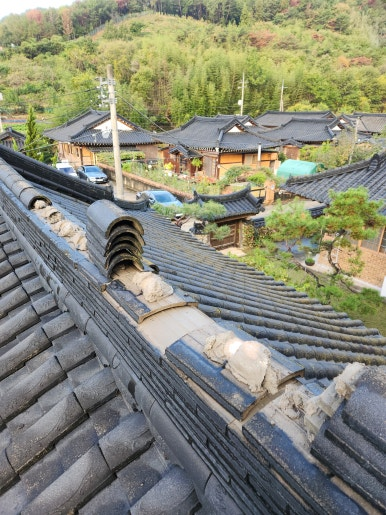
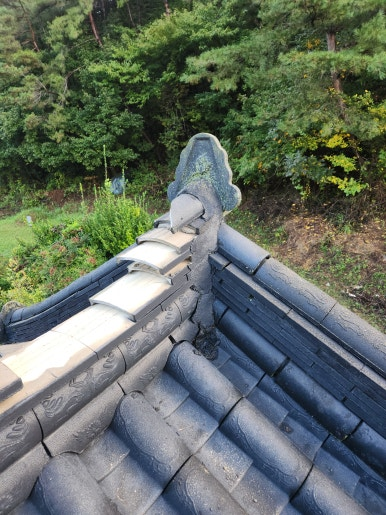
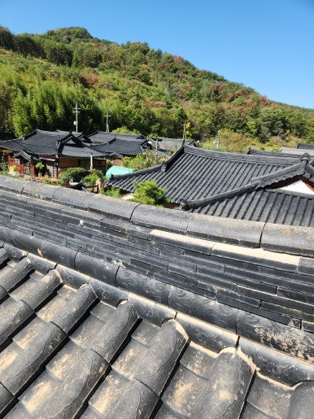
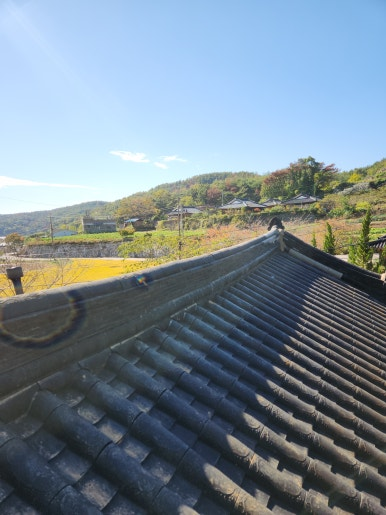

한옥의 지붕은 비바람과 외부 환경으로부터 집을 보호하는 중요한 역할을 합니다.

특히 지붕 중심에 위치한 용마루는 지붕의 형태와 안정성을 유지하는 핵심 부분입니다.

하지만 시간이 지나 노후화되면 용마루가 내려앉거나 틀어질 수 있으며, 이를 방치하면 기와 배열이 틀어지고 빗물이 유입되는 원인이 될 수 있습니다.

이번 현장은 경북 영천시 한옥 주택으로, 내려앉은 용마루를 확인하고 안전하게 새 용마루로 교체하여 지붕을 정돈해 드렸습니다.

---

## 한옥 용마루가 내려앉은 이유 & 방치 시 문제점

### 🚨 용마루 변형 및 하강 원인
- **지붕 구조물 노후화**: 시간이 지나면서 내부 목재 및 받침 구조 저하
- **용마루 하부 받침 손상**: 기와의 지속적인 하중과 무게 누적
- **외부 환경 영향**: 강한 바람, 비, 누수로 인한 결함
- **기존 시공 마감 불량**: 고정 상태 및 틈새 마감의 노후화

### 📌 방치 시 생기는 문제
- **지붕 기와 배열 틀어짐**: 용마루를 중심으로 기와 이격 발생
- **용마루 주변 틈새 유입**: 빗물 침투로 인한 지붕 누수 위험
- **지붕 하부 목재 부식**: 내부 구조물 손상 및 변형 우려
- **보수 비용 증가**: 초기 대응을 놓쳐 대형 지붕 공사로 확대

---

## 1. 시공 전

현장 점검 결과, 경북 영천시 한옥 주택의 용마루가 아래로 내려앉고 하부 받침 상태가 불안정한 것을 확인했습니다.

지붕 중심 라인의 틀어짐과 손상 범위를 정확히 진단한 뒤 안전하게 작업을 준비했습니다.

| :---: | :---: |
|  |  |

---

## 2. 시공 중

단순 자재 교체가 아닌, 지붕의 중심을 바로잡고 주변 기와의 연결 상태와 마감까지 고려하여 철저히 진행했습니다.

1. **지붕 상태 점검**: 내려앉은 용마루 및 주변 기와 상태 확인
2. **기존 용마루 철거**: 손상된 용마루 및 불량 하부 자재 정리
3. **하부 구조 확인**: 용마루 받침 상태 및 주변 지붕 구조 점검
4. **용마루 교체 작업**: 새 용마루 설치 및 중심 라인 정돈
5. **마감 및 최종 점검**: 기와 배열 조정 및 연결 부위 마감 점검

---

## 3. 시공 후

새 용마루 설치와 중심 라인 정돈, 주변 기와 마감 점검을 모두 끝마쳤습니다.

내려앉아 늘 불안했던 용마루가 수직과 수평을 찾아 깔끔하게 교체되어 한옥 지붕의 안정성을 되찾았습니다.

| :---: | :---: |
|  |  |

---

## 이럴 때 용마루 점검을 추천합니다!

- **추천 대상**: 한옥 지붕 용마루가 아래로 내려앉은 경우, 지붕 중심 라인이 휘어 보이는 경우, 용마루 주변 기와가 밀리거나 틀어진 경우, 비가 온 뒤 지붕 누수가 의심되는 경우
- **출장 가능 지역**: 영천, 대구, 경산, 경주, 포항, 구미, 안동 등 제주도 제외 전 지역 (일부 도서산간 제외)
- **문의 안내**: 현장 상황에 맞춘 정직하고 투명한 진단과 합리적인 견적으로 꼼꼼하게 시공해 드립니다.

  
    Naver Blog
  

  <h3 style="margin: 0 0 10px 0; font-size: 20px; color: #1a1a1a;">
    현장 전체 시공 과정이 궁금하시다면?
  </h3>

  

    블로그에서 더 상세한 <strong style="color: #03C75A;">작업 단계별 사진과 세부 시공 팁</strong>을 확인해 보세요.
  

  <a href="https://blog.naver.com/homecare__119/224460108257"
     target="_blank"
     rel="noopener"
     style="display: inline-flex;
            align-items: center;
            justify-content: center;
            gap: 8px;
            background: #03C75A;
            color: #ffffff;
            text-decoration: none;
            padding: 14px 28px;
            border-radius: 50px;
            font-weight: 700;
            font-size: 15px;
            box-shadow: 0 4px 14px rgba(3, 199, 90, 0.35);
            transition: all 0.2s ease;">
    네이버 블로그에서 자세히 보기
    →
  </a>

<section style="background: #ffffff;
                border: 1px solid #eee;
                border-radius: 16px;
                padding: 32px 24px;
                margin-top: 40px;
                text-align: center;">

  <h2 style="margin-top: 0; margin-bottom: 16px; font-size: 22px; color: #222;">
    시공 및 견적 문의 안내
  </h2>

  

    <strong>한옥 지붕 용마루 교체 · 용마루 내려앉음 보수 및 지붕 정돈</strong> 
    <strong>제주도 제외 전 지역 (일부 도서산간 제외)</strong> 현장 맞춤 진단 후 꼼꼼하게 시공합니다. 
    전화, 문자, 카카오톡 중 편하신 방법으로 부담 없이 문의해 주세요!
  

  

  

    현장 사진을 미리 찍어서 보내주시면 더욱 정확하고 빠른 상담이 가능합니다. 😀
  

</section>
