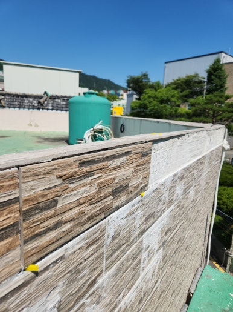
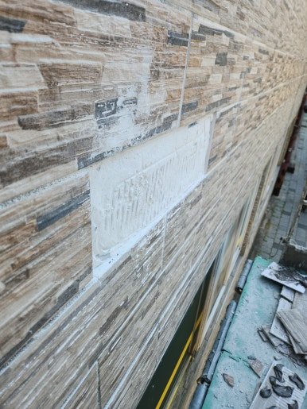
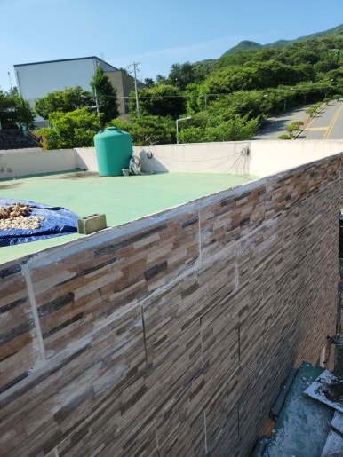
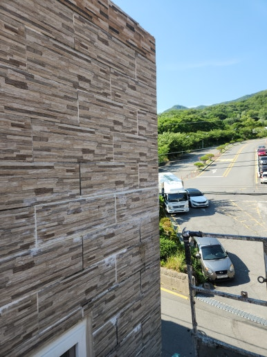

건물 외벽 타일은 건물의 외관을 깔끔하게 유지하고 외부 환경으로부터 벽체를 보호하는 중요한 역할을 합니다.

하지만 시간이 지나면서 접착력이 약해지면 타일이 들뜨거나 탈락할 수 있으며, 특히 고층 부위의 경우 낙하로 인한 안전사고 위험이 높아 빠른 점검과 보수가 필수적입니다.

겉으로는 작은 들뜸으로 보여도 타일 내부 접착층에 틈이 생기면 주변 타일까지 연쇄적으로 영향을 받을 수 있습니다.

이번 현장은 경북 포항시 건물로, 들뜬 외벽 타일을 안전하게 철거하고 바탕면을 보수하여 새 타일로 깔끔하게 교체해 드렸습니다.

---

## 외벽 타일이 들뜨는 이유 & 방치 시 문제점

### 🚨 외벽 타일 들뜸 발생 원인
- **접착제 및 시공층 노후화**: 장기간 노출로 인한 접착력 저하
- **계절별 온도 변화**: 여름철 고온 확장과 겨울철 저온 수축의 반복
- **빗물 및 습기 유입**: 타일 줄눈 틈새 침투로 인한 내부 접착면 부식
- **바탕면 균열**: 외벽 골조 및 바탕 미장면의 손상
- **초기 시공 불량**: 접착제 압착 상태 부족 및 얇은 도포

### 📌 방치 시 생기는 문제
- **타일 탈락 위험**: 낙하로 인한 보행자 및 차량 파손 안전사고 우려
- **연쇄적 들뜸 확대**: 주변 타일 접착력까지 약화되어 손상 범위 증가
- **외벽 누수 발생**: 타일 사이 틈새로 빗물이 침투하여 실내 영향
- **수리 비용 증가**: 단순 부분 보수에서 대형 외벽 공사로 확대

---

## 1. 시공 전

현장 점검 결과, 경북 포항시 건물 외벽 타일의 들뜸 현상과 빈 공간을 확인했습니다.

타일 탈락 위험 및 바탕면 상태를 정확히 진단한 뒤 안전 조치와 함께 철저히 작업을 준비했습니다.

| :---: | :---: |
|  |  |

---

## 2. 시공 중

단순 교체에 그치지 않고 바탕면 정돈, 전용 접착제 도포, 주변 타일과의 단차 및 라인 정렬까지 고려하여 작업을 진행했습니다.

1. **외벽 상태 점검**: 들뜬 타일 및 주변 손상 부위 진단
2. **기존 타일 철거**: 들뜨거나 손상된 타일 안전하게 제거
3. **바탕면 정리**: 기존 접착 잔여물 제거 및 바탕면 정돈
4. **신규 타일 시공**: 외벽전용 접착제 도포 후 새 타일 부착 및 배열
5. **마감 및 최종 점검**: 줄눈 마감 처리 및 고정 상태 확인

---

## 3. 시공 후

들뜬 타일 철거부터 바탕면 보수, 새 타일 교체 및 줄눈 마감 작업이 완료되었습니다.

불안하게 들떠 있던 타일이 튼튼하게 재시공되어 낙하 위험 없이 깔끔한 건물 외관으로 정돈되었습니다.

| :---: | :---: |
|  |  |

---

## 이럴 때 외벽 타일 점검을 추천합니다!

- **추천 대상**: 건물 외벽 타일이 벽면에서 튀어나온 경우, 타일을 두드렸을 때 통통 빈 소리가 나는 경우, 타일 줄눈이 갈라지거나 떨어진 경우, 외벽 타일 일부가 흔들려 낙하 위험이 있는 경우
- **출장 가능 지역**: 포항, 대구, 영천, 경주, 구미, 안동, 울산 등 제주도 제외 전 지역 (일부 도서산간 제외)
- **문의 안내**: 정직하고 투명한 현장 맞춤 진단과 합리적인 견적으로 안전하고 꼼꼼하게 시공해 드립니다.

  
    Naver Blog
  

  <h3 style="margin: 0 0 10px 0; font-size: 20px; color: #1a1a1a;">
    현장 전체 시공 과정이 궁금하시다면?
  </h3>

  

    블로그에서 더 상세한 <strong style="color: #03C75A;">작업 단계별 사진과 세부 시공 팁</strong>을 확인해 보세요.
  

  <a href="https://blog.naver.com/homecare__119/224461300389"
     target="_blank"
     rel="noopener"
     style="display: inline-flex;
            align-items: center;
            justify-content: center;
            gap: 8px;
            background: #03C75A;
            color: #ffffff;
            text-decoration: none;
            padding: 14px 28px;
            border-radius: 50px;
            font-weight: 700;
            font-size: 15px;
            box-shadow: 0 4px 14px rgba(3, 199, 90, 0.35);
            transition: all 0.2s ease;">
    네이버 블로그에서 자세히 보기
    →
  </a>

<section style="background: #ffffff;
                border: 1px solid #eee;
                border-radius: 16px;
                padding: 32px 24px;
                margin-top: 40px;
                text-align: center;">

  <h2 style="margin-top: 0; margin-bottom: 16px; font-size: 22px; color: #222;">
    시공 및 견적 문의 안내
  </h2>

  

    <strong>건물 들뜬 외벽 타일 교체 · 바탕면 보수 및 타일 수리</strong> 
    <strong>제주도 제외 전 지역 (일부 도서산간 제외)</strong> 현장 맞춤 진단 후 꼼꼼하게 시공합니다. 
    전화, 문자, 카카오톡 중 편하신 방법으로 부담 없이 문의해 주세요!
  

  

  

    현장 사진을 미리 찍어서 보내주시면 더욱 정확하고 빠른 상담이 가능합니다. 😀
  

</section>
