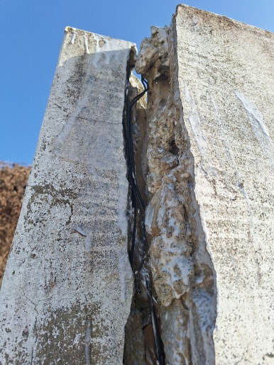
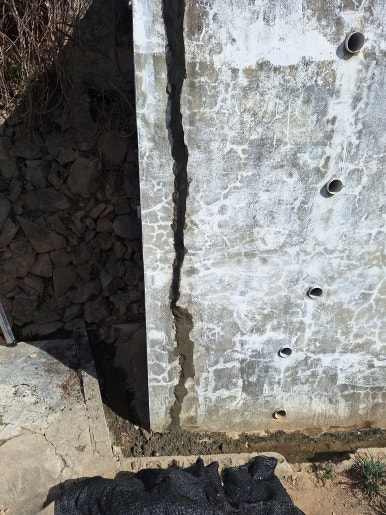
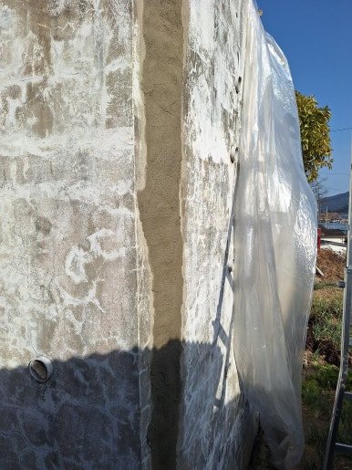
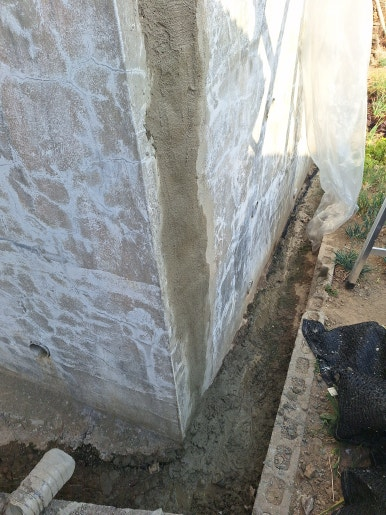

주택 담장은 외부와 내부 공간을 구분하고 사생활 보호와 안전을 지켜주는 중요한 시설물입니다.

하지만 시간이 지나면서 균열이 생기거나 벽체가 벌어지는 문제가 발생할 수 있습니다.

이번 현장은 경남 양산시 주택으로, 갈라지고 벌어진 담장을 꼼꼼하게 보수하고 깔끔하게 마감하여 안전하고 깨끗한 담장을 되찾아 드렸습니다.

---

## 담장 보수가 꼭 필요한 이유

- **기존 균열 심화 방지**: 작은 균열이 점점 넓어지고 주변 벽체까지 손상되는 현상 차단
- **내부 구조물 보호**: 빗물 유입으로 인한 내부 부식 및 2차 손상 예방
- **마감재 탈락 및 파손 예방**: 노후화된 마감재 탈락과 추가 파손 방지
- **붕괴 위험 예방**: 담장 기울어짐 및 흔들림을 방지하여 안전사고 예방
- **보수 비용 절감**: 손상 범위가 더 확대되기 전에 진행하여 합리적인 보수 가능

---

## 1. 시공 전

현장 점검 결과, 경남 양산시 주택 담장 벽체에 균열과 벌어짐이 발생해 있었습니다.

연결 부위 틈새와 마감재 손상을 확인한 후 안전하게 작업할 준비를 진행했습니다.

| :---: | :---: |
|  |  |

---

## 2. 시공 중

보수재가 잘 접착될 수 있도록 바탕면을 정리하고 틈새와 균열을 꼼꼼하게 보수했습니다.

1. **현장 상태 점검**: 담장 균열 및 벌어짐 범위 정확히 확인
2. **손상 부위 정리**: 약해진 마감재와 이물질 깨끗이 제거
3. **바탕면 보수**: 벌어진 부위 및 손상된 부분 보강
4. **균열 및 틈새 보수**: 보충재 충진 및 표면 매끄럽게 정리
5. **마감 및 최종 점검**: 주변 마감 정리 및 최종 보수 상태 확인

---

## 3. 시공 후

갈라지고 벌어진 부분의 보수와 표면 마감 작업을 완료했습니다.

손상 부위가 깔끔하게 정리되어 담장 전체가 단정하고 안전하게 변한 모습을 확인할 수 있었습니다.

| :---: | :---: |
|  |  |

---

## 이런 분들께 추천합니다!

- **추천 대상**: 담장 벽면에 길게 균열이 발생한 분, 담장 연결 부위가 벌어져 틈새가 생긴 분, 시멘트나 마감재가 떨어지는 분, 오래된 주택 담장 상태가 걱정되는 분
- **출장 가능 지역**: 제주 제외 전국
- **문의 안내**: 정직하고 투명한 현장 맞춤 진단과 합리적인 견적으로 꼼꼼하게 시공해 드립니다.

  
    Naver Blog
  

  <h3 style="margin: 0 0 10px 0; font-size: 20px; color: #1a1a1a;">
    현장 전체 시공 과정이 궁금하시다면?
  </h3>

  

    블로그에서 더 상세한 <strong style="color: #03C75A;">작업 단계별 사진과 세부 시공 팁</strong>을 확인해 보세요.
  

  <a href="https://blog.naver.com/homecare__119/224462480476"
     target="_blank"
     rel="noopener"
     style="display: inline-flex;
            align-items: center;
            justify-content: center;
            gap: 8px;
            background: #03C75A;
            color: #ffffff;
            text-decoration: none;
            padding: 14px 28px;
            border-radius: 50px;
            font-weight: 700;
            font-size: 15px;
            box-shadow: 0 4px 14px rgba(3, 199, 90, 0.35);
            transition: all 0.2s ease;">
    네이버 블로그에서 자세히 보기
    →
  </a>

<section style="background: #ffffff;
                border: 1px solid #eee;
                border-radius: 16px;
                padding: 32px 24px;
                margin-top: 40px;
                text-align: center;">

  <h2 style="margin-top: 0; margin-bottom: 16px; font-size: 22px; color: #222;">
    시공 및 견적 문의 안내
  </h2>

  

    <strong>갈라지고 벌어진 담장 보수 · 균열 및 틈새 부분 보강</strong> 
    <strong>제주 제외 전국</strong> 현장 맞춤 진단 후 꼼꼼하게 시공합니다. 
    전화, 문자, 카카오톡 중 편하신 방법으로 부담 없이 문의해 주세요!
  

  

  

    현장 사진을 미리 찍어서 보내주시면 더욱 정확하고 빠른 상담이 가능합니다. 😀
  

</section>
