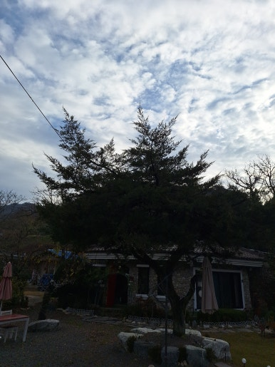
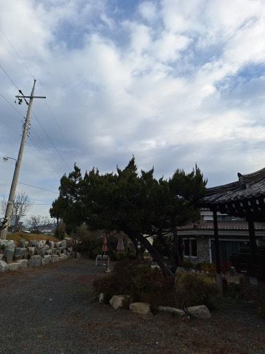
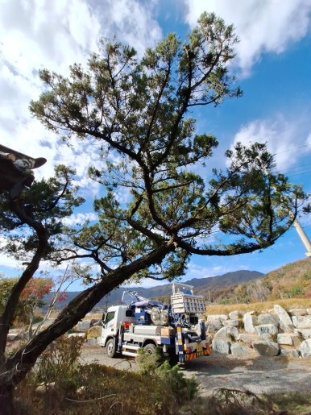
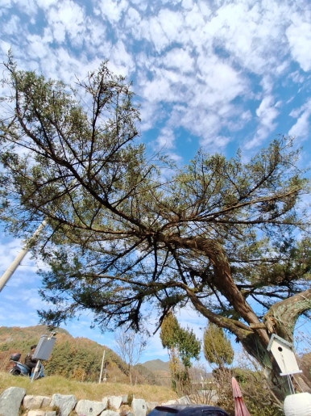

주택 마당의 나무는 아름다운 주변 환경을 만들어주지만, 시간이 지나면서 가지가 무성하게 자라 마당이 어수선해질 수 있습니다.

이번 현장은 경북 성주군 주택으로, 여러 방향으로 무성하게 뻗은 나뭇가지를 꼼꼼하게 전지 및 가지치기하여 쾌적하고 단정한 마당 환경을 되찾아 드렸습니다.

---

## 나무 전지 및 가지치기가 필요한 이유

- **공간 활용성 향상**: 무성하게 자란 가지로 인해 좁아졌던 마당 및 주변 공간 확보
- **수형 유지 및 관리**: 나뭇가지가 서로 엉키고 흐트러진 수형을 균형 있게 정돈
- **통풍 및 일조량 개선**: 가지 사이 통풍을 원활하게 하고 햇빛이 잘 들도록 조율
- **안전사고 예방**: 마른 가지나 약해진 가지의 낙하로 인한 2차 피해 방지
- **건물 보호**: 주택 지붕이나 담장 주변까지 침범한 나뭇가지 정리

---

## 📌 나무 가지치기를 미루면 발생할 수 있는 문제

- 불필요한 가지가 계속 자라면서 수형이 불균형해지는 현상
- 가지가 서로 겹쳐 통풍이 원활하지 않은 문제
- 마른 가지나 약한 가지로 인한 낙하 위험
- 주택 외벽이나 지붕 주변으로 가지가 뻗어 나가는 문제
- 마당 공간이 좁아지고 전체적인 미관이 저하되는 현상

---

## 1. 시공 전

현장 점검 결과, 경북 성주군 주택 마당의 나뭇가지가 무성하게 자라 수형이 흐트러진 상태였습니다.

가지가 서로 겹쳐 통풍이 잘되지 않고 마당 전체가 어수선한 모습을 확인한 후 작업을 준비했습니다.

| :---: | :---: |
|  |  |

---

## 2. 시공 중

나무의 균형과 생육 상태를 고려하며 꼼꼼하게 전지 및 가지치기 작업을 진행했습니다.

1. **현장 상태 점검**: 나무의 크기와 가지 상태 및 주변 환경 확인
2. **불필요한 가지 선별**: 마른 가지와 겹치거나 불필요하게 뻗은 가지 확인
3. **나무 전지 및 가지치기**: 나무의 형태와 생육 상태를 고려하여 가지 정리
4. **전체 수형 정리**: 균형 잡힌 모양으로 다듬고 주변 공간 정돈
5. **잔가지 및 부산물 정리**: 잘라낸 가지 수거 및 작업 주변 청소

---

## 3. 시공 후

불필요한 가지와 마른 가지 정리를 모두 마쳤습니다.

나무의 균형을 맞춰 수형이 깔끔하게 정돈되고, 작업 주변까지 깨끗하게 마무리되어 쾌적한 마당으로 변한 모습을 확인할 수 있었습니다.

| :---: | :---: |
|  |  |

---

## 이런 분들께 추천합니다!

- **추천 대상**: 마당에 심어진 나무가 지나치게 무성하게 자란 분, 나뭇가지가 서로 엉키고 모양이 예쁘지 않은 분, 마른 가지가 많아 안전이 걱정되는 분, 지붕이나 담장 주변으로 가지가 뻗어 나간 분, 주택 마당을 깔끔하게 정리하고 싶은 분
- **출장 가능 지역**: 제주 제외 전국
- **문의 안내**: 정직하고 투명한 현장 맞춤 진단과 합리적인 견적으로 꼼꼼하게 시공해 드립니다.

  
    Naver Blog
  

  <h3 style="margin: 0 0 10px 0; font-size: 20px; color: #1a1a1a;">
    현장 전체 시공 과정이 궁금하시다면?
  </h3>

  

    블로그에서 더 상세한 <strong style="color: #03C75A;">작업 단계별 사진과 세부 시공 팁</strong>을 확인해 보세요.
  

  <a href="https://blog.naver.com/homecare__119/224463888962"
     target="_blank"
     rel="noopener"
     style="display: inline-flex;
            align-items: center;
            justify-content: center;
            gap: 8px;
            background: #03C75A;
            color: #ffffff;
            text-decoration: none;
            padding: 14px 28px;
            border-radius: 50px;
            font-weight: 700;
            font-size: 15px;
            box-shadow: 0 4px 14px rgba(3, 199, 90, 0.35);
            transition: all 0.2s ease;">
    네이버 블로그에서 자세히 보기
    →
  </a>

<section style="background: #ffffff;
                border: 1px solid #eee;
                border-radius: 16px;
                padding: 32px 24px;
                margin-top: 40px;
                text-align: center;">

  <h2 style="margin-top: 0; margin-bottom: 16px; font-size: 22px; color: #222;">
    시공 및 견적 문의 안내
  </h2>

  

    <strong>주택 마당 나무 전지 · 가지치기 · 수형 정돈 및 잔가지 처리</strong> 
    <strong>제주 제외 전국</strong> 현장 맞춤 진단 후 꼼꼼하게 시공합니다. 
    전화, 문자, 카카오톡 중 편하신 방법으로 부담 없이 문의해 주세요!
  

  

  

    현장 사진을 미리 찍어서 보내주시면 더욱 정확하고 빠른 상담이 가능합니다. 😀
  

</section>
