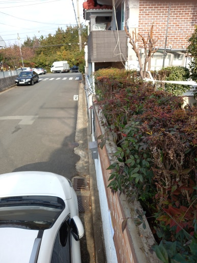
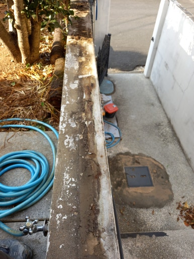
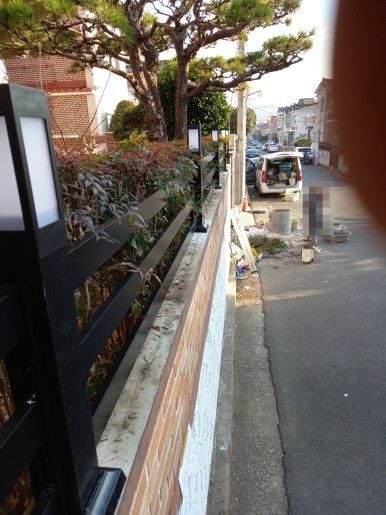
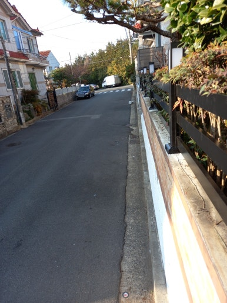

주택의 담장은 사생활 보호와 외부 출입을 막아주는 중요한 역할을 합니다.

이번 현장은 경북 구미시 주택으로, 기존 담장 위에 펜스를 추가 설치하여 외부 시선을 차단하고 보다 깔끔하고 안전한 주거 환경으로 개선해 드렸습니다.

---

## 담장 위 펜스 설치가 필요한 이유

- **외부 시선 차단**: 낮은 담장으로 인해 외부에서 마당이나 주택 내부가 보이는 문제 해결
- **사생활 보호 및 보안 강화**: 무단출입을 예방하고 사생활 보호 기능을 강화
- **공간 활용성 및 관리**: 기존 담장을 활용하면서 공간을 효율적으로 관리
- **미관 개선**: 담장 주변을 깔끔하고 세련되게 정돈하여 주택 외관 완성도 향상
- **주거 환경 개선**: 외부 시선 차단으로 마음 편히 생활할 수 있는 환경 조성

---

## 📌 담장 위 펜스 설치를 미루면 발생할 수 있는 문제

- 외부에서 주택 내부가 쉽게 노출되는 현상
- 마당에서 생활할 때 사생활 보호가 어려운 문제
- 낮은 담장으로 인한 심리적인 불안감
- 외부 공간과 주거 공간의 경계가 불분명해지는 문제
- 주택 외부의 전체적인 미관이 저하되는 현상

---

## 1. 시공 전

현장 점검 결과, 기존 담장만 설치되어 있어 외부 시선 차단에 아쉬움이 있는 상태였습니다.

외부에서 마당 내부가 들여다보여 사생활 보호를 위해 기존 담장 위 펜스 추가 설치 작업을 준비했습니다.

| :---: | :---: |
|  |  |

---

## 2. 시공 중

담장의 상태와 구조에 맞춰 견고하게 펜스를 고정하는 작업을 진행했습니다.

1. **현장 상태 점검**: 기존 담장 상태 및 설치 위치 확인
2. **설치 구간 실측**: 펜스 길이와 높이 및 간격 측정
3. **설치 위치 표시**: 기둥 고정 위치와 수평 확인
4. **펜스 설치 및 고정**: 기둥과 펜스 연결 및 견고하게 고정
5. **마감 및 주변 정리**: 설치 상태 점검 및 작업 공간 청소

---

## 3. 시공 후

기존 담장 위 펜스 설치를 깔끔하게 완료했습니다.

담장과 조화를 이루도록 마감하여 외부 시선을 효과적으로 차단하고, 한층 더 안심할 수 있고 쾌적한 주거 환경으로 개선된 모습을 확인할 수 있었습니다.

| :---: | :---: |
|  |  |

---

## 이런 분들께 추천합니다!

- **추천 대상**: 기존 담장이 낮아 외부 시선이 신경 쓰이는 분, 마당과 주택 내부의 사생활을 보호하고 싶은 분, 외부인의 출입을 예방하고 싶은 분, 오래된 담장 주변을 새롭게 정리하고 싶은 분, 주택 외관을 깔끔하고 세련되게 바꾸고 싶은 분
- **출장 가능 지역**: 제주 제외 전국
- **문의 안내**: 정직하고 투명한 현장 맞춤 진단과 합리적인 견적으로 꼼꼼하게 시공해 드립니다.

  
    Naver Blog
  

  <h3 style="margin: 0 0 10px 0; font-size: 20px; color: #1a1a1a;">
    현장 전체 시공 과정이 궁금하시다면?
  </h3>

  

    블로그에서 더 상세한 <strong style="color: #03C75A;">작업 단계별 사진과 세부 시공 팁</strong>을 확인해 보세요.
  

  <a href="https://blog.naver.com/homecare__119/224464922163"
     target="_blank"
     rel="noopener"
     style="display: inline-flex;
            align-items: center;
            justify-content: center;
            gap: 8px;
            background: #03C75A;
            color: #ffffff;
            text-decoration: none;
            padding: 14px 28px;
            border-radius: 50px;
            font-weight: 700;
            font-size: 15px;
            box-shadow: 0 4px 14px rgba(3, 199, 90, 0.35);
            transition: all 0.2s ease;">
    네이버 블로그에서 자세히 보기
    →
  </a>

<section style="background: #ffffff;
                border: 1px solid #eee;
                border-radius: 16px;
                padding: 32px 24px;
                margin-top: 40px;
                text-align: center;">

  <h2 style="margin-top: 0; margin-bottom: 16px; font-size: 22px; color: #222;">
    시공 및 견적 문의 안내
  </h2>

  

    <strong>주택 담장 위 펜스 설치 · 담장 높이 보완 · 사생활 보호 펜스 시공</strong> 
    <strong>제주 제외 전국</strong> 현장 맞춤 진단 후 꼼꼼하게 시공합니다. 
    전화, 문자, 카카오톡 중 편하신 방법으로 부담 없이 문의해 주세요!
  

  

  

    현장 사진을 미리 찍어서 보내주시면 더욱 정확하고 빠른 상담이 가능합니다. 😀
  

</section>
