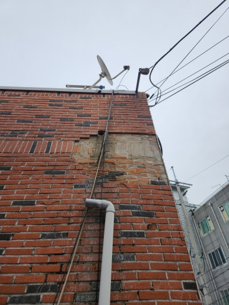
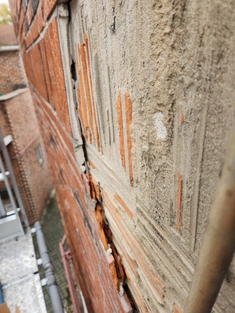
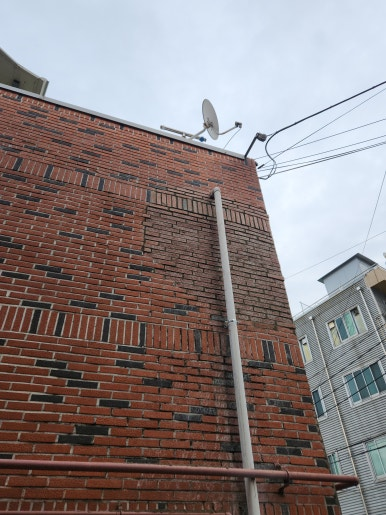
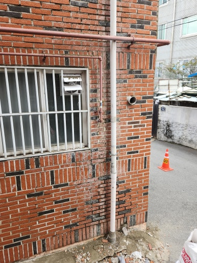

건물 외벽 타일은 시간이 지나면서 비바람과 습기, 온도 변화로 인해 들뜸이나 이탈이 발생할 수 있습니다.

이번 현장은 울산 북구 건물로, 기존 타일 상태를 점검하고 손상된 부분을 보수하여 더욱 안전하고 깔끔한 외벽으로 개선해 드렸습니다.

---

## 🚨 외벽 타일 보수가 필요한 이유

- **외벽 타일 들뜸 현상**: 타일이 벽면에서 들뜨거나 흔들리는 문제 해결
- **외관 손상 복원**: 타일 일부가 떨어져 나가 손상된 외관 복원
- **균열 및 틈새 보수**: 타일 사이 균열이나 틈 발생 부위 조치
- **접착력 강화**: 노후화로 인해 약해진 타일 접착력 보강
- **안전사고 예방**: 타일 탈락으로 인한 보행자 안전사고 사전 예방

---

## 📌 방치하면 생기는 문제

- 들뜬 타일의 추가적인 이탈 및 탈락 위험
- 타일 탈락으로 인한 보행자 안전사고 우려
- 외벽 틈으로 수분이 유입될 가능성
- 주변 타일까지 접착력이 약해질 수 있는 문제
- 건물 외관의 미관 저하 및 유지관리 비용 증가

---

## 1. 시공 전

현장 점검 결과, 외벽 타일의 들뜸 현상과 일부 이탈이 발생한 상태였습니다.

타일 탈락 위험을 예방하기 위해 손상 부위 확인 및 주변 타일의 접착 상태까지 함께 점검하며 보수 작업을 준비했습니다.

| :---: | :---: |
|  |  |

---

## 2. 시공 중

안전 장비를 확보하고 작업 구역을 통제한 뒤, 바탕면부터 고정까지 꼼꼼하게 작업을 진행했습니다.

1. **현장 상태 점검**: 들뜸 및 이탈 부위 확인
2. **손상 타일 제거**: 불량 타일과 잔여 접착물 정리
3. **바탕면 정리**: 먼지 및 이물질 제거
4. **타일 재부착 및 고정**: 접착제 도포 후 타일 설치
5. **마감 및 최종 점검**: 줄눈 정리 및 시공 상태 확인

---

## 3. 시공 후

들뜬 타일 재부착 및 손상 부위 보수 작업을 깔끔하게 완료했습니다.

외벽 타일 탈락 위험을 제거하여 안전을 확보하였으며, 건물 외관 또한 원래대로 깔끔하게 정돈된 모습을 확인할 수 있었습니다.

| :---: | :---: |
|  |  |

---

## 📣 이럴 때 보수 작업을 고려해 보세요!

- **추천 대상**: 건물 외벽 타일이 들뜨거나 흔들리는 경우, 타일이 떨어져 나가 벽면이 노출된 경우, 오래된 건물 외벽의 타일 상태가 걱정되는 경우, 외벽 타일 탈락으로 안전사고가 우려되는 경우, 손상된 외벽을 깔끔하게 정리하고 싶은 경우
- **출장 가능 지역**: 울산, 양산, 창원, 김해, 대구, 경산, 경주, 포항 등 경남·경북 주요 지역 (제주 제외 전국)
- **문의 안내**: 현장 상황에 맞춘 정확한 진단과 정직·투명한 견적으로 꼭 필요한 작업만 꼼꼼하게 시공해 드립니다.

  
    Naver Blog
  

  <h3 style="margin: 0 0 10px 0; font-size: 20px; color: #1a1a1a;">
    현장 전체 시공 과정이 궁금하시다면?
  </h3>

  

    블로그에서 더 상세한 <strong style="color: #03C75A;">작업 단계별 사진과 세부 시공 팁</strong>을 확인해 보세요.
  

  <a href="https://blog.naver.com/homecare__119/224466240476"
     target="_blank"
     rel="noopener"
     style="display: inline-flex;
            align-items: center;
            justify-content: center;
            gap: 8px;
            background: #03C75A;
            color: #ffffff;
            text-decoration: none;
            padding: 14px 28px;
            border-radius: 50px;
            font-weight: 700;
            font-size: 15px;
            box-shadow: 0 4px 14px rgba(3, 199, 90, 0.35);
            transition: all 0.2s ease;">
    네이버 블로그에서 자세히 보기
    →
  </a>

<section style="background: #ffffff;
                border: 1px solid #eee;
                border-radius: 16px;
                padding: 32px 24px;
                margin-top: 40px;
                text-align: center;">

  <h2 style="margin-top: 0; margin-bottom: 16px; font-size: 22px; color: #222;">
    시공 및 견적 문의 안내
  </h2>

  

    <strong>외벽 타일 들뜸 및 이탈 보수 · 손상 타일 제거 및 재부착 · 외벽 안전 점검</strong> 
    <strong>제주 제외 전국</strong> 현장 맞춤 진단 후 꼼꼼하게 시공합니다. 
    전화, 문자, 카카오톡 중 편하신 방법으로 부담 없이 문의해 주세요!
  

  

  

    현장 사진을 미리 찍어서 보내주시면 더욱 정확하고 빠른 상담이 가능합니다. 😀
  

</section>
