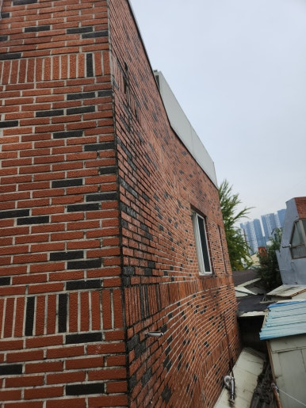
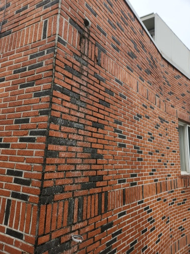
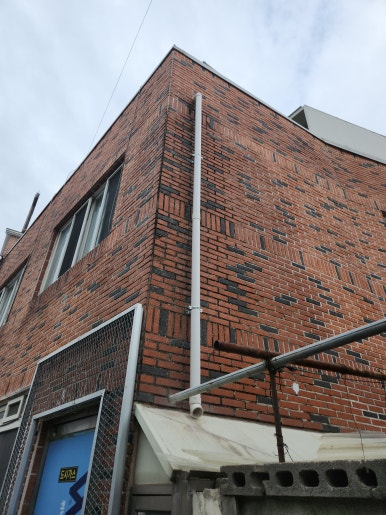
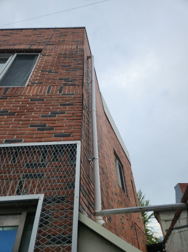

건물 외벽의 우수관은 빗물을 지면이나 배수 시설까지 안전하게 배출하는 중요한 시설입니다.

이번 현장은 울산 북구 건물로, 건물 구조와 배수 위치를 꼼꼼히 확인한 후 빗물이 원활하게 흐를 수 있도록 새로운 우수관을 설치해 드렸습니다.

---

## 🚨 우수관 설치가 필요한 이유

- **외벽 빗물 흐름 차단**: 건물 외벽으로 빗물이 타고 흘러내리는 현상 방지
- **노후 배관 교체**: 기존 우수관의 노후화 및 파손 부위 보수
- **배수 성능 개선**: 빗물 배수가 원활하지 않거나 물이 고이는 문제 해결
- **신축 및 증축 대응**: 배수 시설이 추가로 필요한 위치에 우수관 신설
- **건물 외벽 보호**: 빗물 직사로 인한 외벽 오염 및 마감재 손상 예방

---

## 📌 방치하면 생기는 문제

- 빗물이 외벽을 타고 흘러 외벽 오염 발생
- 외벽 균열 부위로 수분이 유입될 가능성 증가
- 건물 주변 바닥에 물이 고여 통행 및 시설물 관리 문제 발생
- 장기적인 수분 노출로 인한 외벽 마감재 손상 우려
- 배수 불량으로 인한 건물 유지관리 비용 증가

---

## 1. 시공 전

현장 점검 결과, 기존 배수 시설 점검과 함께 외벽 타고 내리는 빗물 방지를 위한 우수관 신설이 필요한 상태였습니다.

건물 구조에 맞는 우수관 설치 위치와 최적의 배수 경로를 사전에 꼼꼼히 체크했습니다.

| :---: | :---: |
|  |  |

---

## 2. 시공 중

안전 장비를 착용하고 작업 구역을 확보한 뒤, 배관 고정 및 연결 작업을 차근차근 진행했습니다.

1. **현장 상태 점검**: 건물 외벽 및 배수 위치 확인
2. **설치 위치 선정**: 배수 경로 및 우수관 위치 결정
3. **설치 부위 준비**: 고정 위치 확인 및 작업면 정리
4. **우수관 설치 및 고정**: 배관 연결 후 견고하게 고정
5. **마감 및 최종 점검**: 연결 부위 확인 및 배수 상태 점검

---

## 3. 시공 후

건물 외벽 우수관 설치 및 배관 연결 작업을 성공적으로 마무리했습니다.

고정 상태와 마감 부위를 최종 확인하여 비가 와도 빗물이 외벽을 타고 흐르지 않고 안전하게 배출될 수 있는 환경을 조성했습니다.

| :---: | :---: |
|  |  |

---

## 📣 이럴 때 설치 작업을 고려해 보세요!

- **추천 대상**: 건물 외벽으로 빗물이 그대로 흘러내리는 경우, 기존 우수관이 파손되거나 이탈한 경우, 빗물 배수 시설이 부족한 건물, 장마철마다 배수 문제로 불편을 겪는 경우, 건물 외벽과 주변 시설을 깨끗하게 관리하고 싶은 경우
- **출장 가능 지역**: 울산, 양산, 창원, 김해, 진주, 대구, 경산, 경주, 포항 등 경남·경북 주요 지역 (제주 제외 전국)
- **문의 안내**: 현장 상황에 맞춘 정확한 진단과 정직·투명한 견적으로 꼭 필요한 작업만 꼼꼼하게 시공해 드립니다.

  
    Naver Blog
  

  <h3 style="margin: 0 0 10px 0; font-size: 20px; color: #1a1a1a;">
    현장 전체 시공 과정이 궁금하시다면?
  </h3>

  

    블로그에서 더 상세한 <strong style="color: #03C75A;">작업 단계별 사진과 세부 시공 팁</strong>을 확인해 보세요.
  

  <a href="https://blog.naver.com/homecare__119/224467475631"
     target="_blank"
     rel="noopener"
     style="display: inline-flex;
            align-items: center;
            justify-content: center;
            gap: 8px;
            background: #03C75A;
            color: #ffffff;
            text-decoration: none;
            padding: 14px 28px;
            border-radius: 50px;
            font-weight: 700;
            font-size: 15px;
            box-shadow: 0 4px 14px rgba(3, 199, 90, 0.35);
            transition: all 0.2s ease;">
    네이버 블로그에서 자세히 보기
    →
  </a>

<section style="background: #ffffff;
                border: 1px solid #eee;
                border-radius: 16px;
                padding: 32px 24px;
                margin-top: 40px;
                text-align: center;">

  <h2 style="margin-top: 0; margin-bottom: 16px; font-size: 22px; color: #222;">
    시공 및 견적 문의 안내
  </h2>

  

    <strong>우수관 신규 설치 · 기존 배관 교체 및 보수 · 외벽 빗물 배수 점검</strong> 
    <strong>제주 제외 전국</strong> 현장 맞춤 진단 후 꼼꼼하게 시공합니다. 
    전화, 문자, 카카오톡 중 편하신 방법으로 부담 없이 문의해 주세요!
  

  

  

    현장 사진을 미리 찍어서 보내주시면 더욱 정확하고 빠른 상담이 가능합니다. 😀
  

</section>
