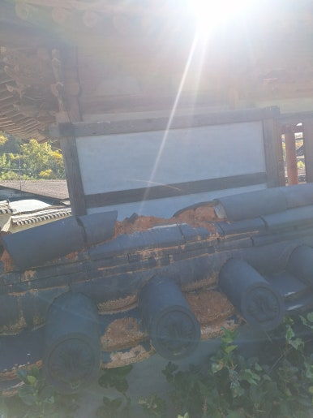
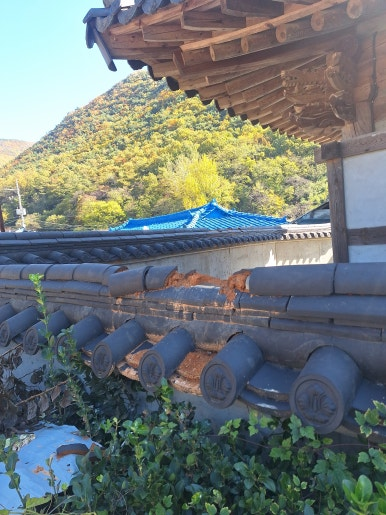
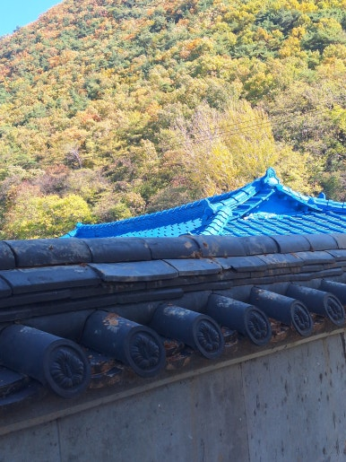
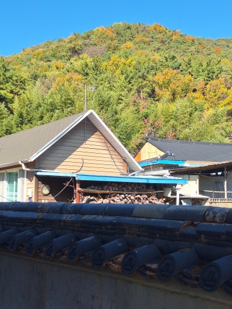

재실 담장 위 기와는 빗물 유입을 막고 담장을 보호하는 중요한 시설입니다.

이번 현장은 울산 북구에 위치한 재실로, 건물 구조와 담장 상부 상태를 꼼꼼히 확인한 후 빗물이 스며들지 않도록 깨진 기와를 보수해 드렸습니다.

---

## 🚨 담장 위 기와 보수가 필요한 이유

- **기와 파손 및 균열**: 담장 위에 설치된 기와가 깨지거나 금이 간 경우
- **노후 기와 이탈 방지**: 오래된 기와가 들뜨거나 이탈된 부위 정돈
- **빗물 유입 차단**: 기와 틈새로 빗물이 스며들어 담장이 손상되는 현상 예방
- **외부 충격 대응**: 강한 바람이나 외부 충격으로 파손된 기와 교체
- **담장 외관 유지**: 담장 외관을 깔끔하고 정돈된 상태로 유지

---

## 📌 방치하면 생기는 문제

- 빗물이 깨진 기와 사이로 유입될 가능성 증가
- 담장 상부 수분 침투 및 백화 현상 우려
- 장기적인 수분 노출로 인한 담장 마감재 손상 우려
- 주변 기와의 추가적인 파손 및 이탈 위험 발생
- 담장 외관이 지저분해지고 관리가 어려워지는 문제

---

## 1. 시공 전

현장 점검 결과, 기존 담장 위 기와 일부가 깨지고 손상되어 방치할 경우 빗물 유입으로 인한 담장 손상이 우려되는 상태였습니다.

기와 상태와 담장 구조에 맞는 보수 위치 및 작업을 사전에 꼼꼼하게 체크했습니다.

| :---: | :---: |
|  |  |

---

## 2. 시공 중

안전 장비를 착용하고 작업 구역을 확보한 뒤, 기존 파손 기와 정리 및 보수/교체 작업을 차근차근 진행했습니다.

1. **현장 상태 점검**: 담장 하부 및 주변 기와 상태 확인
2. **파손 부위 확인**: 깨진 기와 위치와 손상 범위 파악
3. **기존 기와 정리**: 파손된 기와 제거 및 작업면 정리
4. **기와 보수 및 교체**: 새 기와 설치 및 주변 기와 정돈
5. **마감 및 최종 점검**: 기와 고정 상태와 마감 상태 확인

---

## 3. 시공 후

울산 북구 재실 담장 위 깨진 기와 보수 및 정돈 작업을 성공적으로 마무리했습니다.

고정 상태와 마감 부위를 최종 확인하여 비가 와도 빗물이 담장 내부로 유입되지 않고 안전하게 보호될 수 있는 환경을 조성했습니다.

| :---: | :---: |
|  |  |

---

## 📣 이럴 때 보수 작업을 고려해 보세요!

- **추천 대상**: 재실 담장 위 기와가 깨지거나 금이 간 경우, 담장 상부 기와가 들뜨거나 밀린 경우, 오래된 담장 기와의 교체가 필요한 경우, 비가 내리면 담장에 물 자국이 생기는 경우, 담장 외관을 깔끔하게 관리하고 싶은 경우
- **출장 가능 지역**: 울산, 양산, 창원, 김해, 진주, 대구, 경산, 경주, 포항 등 경남·경북 주요 지역 (제주 제외 전국)
- **문의 안내**: 현장 상황에 맞춘 정확한 진단과 정직·투명한 견적으로 꼭 필요한 작업만 꼼꼼하게 시공해 드립니다.

  
    Naver Blog
  

  <h3 style="margin: 0 0 10px 0; font-size: 20px; color: #1a1a1a;">
    현장 전체 시공 과정이 궁금하시다면?
  </h3>

  

    블로그에서 더 상세한 <strong style="color: #03C75A;">작업 단계별 사진과 세부 시공 팁</strong>을 확인해 보세요.
  

  <a href="https://blog.naver.com/homecare__119/224468442115"
     target="_blank"
     rel="noopener"
     style="display: inline-flex;
            align-items: center;
            justify-content: center;
            gap: 8px;
            background: #03C75A;
            color: #ffffff;
            text-decoration: none;
            padding: 14px 28px;
            border-radius: 50px;
            font-weight: 700;
            font-size: 15px;
            box-shadow: 0 4px 14px rgba(3, 199, 90, 0.35);
            transition: all 0.2s ease;">
    네이버 블로그에서 자세히 보기
    →
  </a>

<section style="background: #ffffff;
                border: 1px solid #eee;
                border-radius: 16px;
                padding: 32px 24px;
                margin-top: 40px;
                text-align: center;">

  <h2 style="margin-top: 0; margin-bottom: 16px; font-size: 22px; color: #222;">
    시공 및 견적 문의 안내
  </h2>

  

    <strong>깨진 담장 기와 보수 · 파손 기와 교체 · 들뜬 기와 정리 및 담장 점검</strong> 
    <strong>제주 제외 전국</strong> 현장 맞춤 진단 후 꼼꼼하게 시공합니다. 
    전화, 문자, 카카오톡 중 편하신 방법으로 부담 없이 문의해 주세요!
  

  

  

    현장 사진을 미리 찍어서 보내주시면 더욱 정확하고 빠른 상담이 가능합니다. 😀
  

</section>
