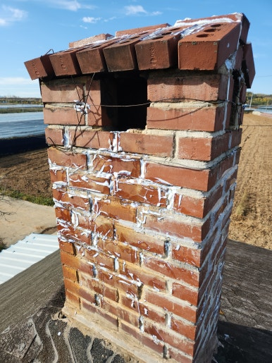
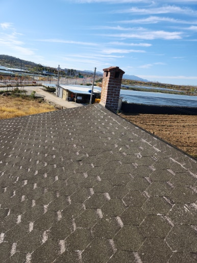
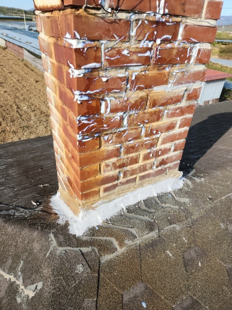
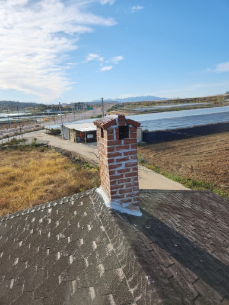

주택지붕은 비와 눈, 강한 햇빛에 지속적으로 노출되어 슁글이 들뜨거나 갈라지면서 누수가 발생할 수 있습니다.

이번 현장은 울산 북구에 위치한 주택으로, 지붕 상태를 꼼꼼히 점검하고 누수 위험이 있는 부분을 확인한 후 방수 작업을 진행했습니다.

---

## 🚨 누수 방수가 필요한 이유

- **슁글 파손 및 균열**: 슁글이 갈라지거나 깨진 경우
- **노후 슁글 이탈 방지**: 지붕 슁글이 들뜨거나 일부 이탈된 부위 정돈
- **실내 누수 차단**: 비가 내리면 천장이나 벽면에 물 자국이 생기는 현상 예방
- **연결 부위 누수 방지**: 지붕 연결 부위 및 마감 부분의 누수 차단
- **방수 성능 회복**: 오래된 슁글지붕의 저하된 방수 성능 보강

---

## 📌 방치하면 생기는 문제

- 천장 및 실내 벽면 누수 발생
- 지붕 내부 목재 및 구조물의 습기 피해
- 곰팡이 및 악취 발생 우려
- 슁글 주변 접착력 저하 및 추가 손상
- 장기적인 수분 침투로 인한 수리 비용 증가

---

## 1. 시공 전

현장 점검 결과, 기존 슁글지붕의 손상 및 누수 우려 부위가 확인되었습니다.

지붕 마감 상태와 방수 취약 부분을 사전에 꼼꼼하게 체크했습니다.

| :---: | :---: |
|  |  |

---

## 2. 시공 중

안전 장비를 착용하고 작업 구역을 확보한 뒤, 기존 마감 정리 및 방수 보수 작업을 차근차근 진행했습니다.

1. **현장 상태 점검**: 지붕 전체 및 누수 의심 부위 확인
2. **손상 부위 확인**: 들뜸, 갈라짐 및 틈새 상태 점검
3. **기존 마감 정리**: 이물질 제거 및 작업면 정돈
4. **방수 보수 작업**: 손상 부위 보수 및 방수 처리
5. **마감 및 최종 점검**: 방수 상태와 주변 마감 확인

---

## 3. 시공 후

울산 북구 주택 슁글지붕 누수 방수 및 정돈 작업을 성공적으로 마무리했습니다.

손상된 부분 보수 및 방수 작업을 완료하고 주변 마감까지 꼼꼼하게 정리하여 비가 와도 빗물이 실내로 유입되지 않도록 환경을 조성했습니다.

| :---: | :---: |
|  |  |

---

## 📣 이럴 때 방수 작업을 고려해 보세요!

- **추천 대상**: 비가 오면 천장에서 물이 떨어지는 경우, 지붕 슁글이 갈라지거나 들뜬 경우, 지붕 가장자리 및 연결 부위에서 누수가 발생하는 경우, 오래된 주택으로 지붕 방수 상태가 걱정되는 경우, 장마철을 대비해 지붕 점검이 필요한 경우
- **출장 가능 지역**: 울산, 양산, 창원, 김해, 진주, 대구, 경산, 경주, 포항 등 경남·경북 주요 지역 (제주 제외 전국)
- **문의 안내**: 현장 상황에 맞춘 정확한 진단과 정직·투명한 견적으로 꼭 필요한 작업만 꼼꼼하게 시공해 드립니다.

  
    Naver Blog
  

  <h3 style="margin: 0 0 10px 0; font-size: 20px; color: #1a1a1a;">
    현장 전체 시공 과정이 궁금하시다면?
  </h3>

  

    블로그에서 더 상세한 <strong style="color: #03C75A;">작업 단계별 사진과 세부 시공 팁</strong>을 확인해 보세요.
  

  <a href="https://blog.naver.com/homecare__119/224469322600"
     target="_blank"
     rel="noopener"
     style="display: inline-flex;
            align-items: center;
            justify-content: center;
            gap: 8px;
            background: #03C75A;
            color: #ffffff;
            text-decoration: none;
            padding: 14px 28px;
            border-radius: 50px;
            font-weight: 700;
            font-size: 15px;
            box-shadow: 0 4px 14px rgba(3, 199, 90, 0.35);
            transition: all 0.2s ease;">
    네이버 블로그에서 자세히 보기
    →
  </a>

<section style="background: #ffffff;
                border: 1px solid #eee;
                border-radius: 16px;
                padding: 32px 24px;
                margin-top: 40px;
                text-align: center;">

  <h2 style="margin-top: 0; margin-bottom: 16px; font-size: 22px; color: #222;">
    시공 및 견적 문의 안내
  </h2>

  

    <strong>슁글지붕 누수 점검 및 보수 · 슁글 파손•들뜸 및 틈새 보수 · 주택 지붕 부분 방수 및 유지 보수</strong> 
    <strong>제주 제외 전국</strong> 현장 맞춤 진단 후 꼼꼼하게 시공합니다. 
    전화, 문자, 카카오톡 중 편하신 방법으로 부담 없이 문의해 주세요!
  

  

  

    현장 사진을 미리 찍어서 보내주시면 더욱 정확하고 빠른 상담이 가능합니다. 😀
  

</section>
