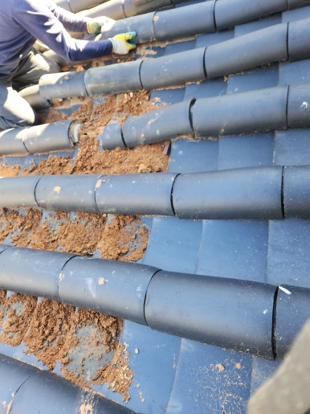
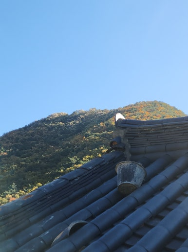
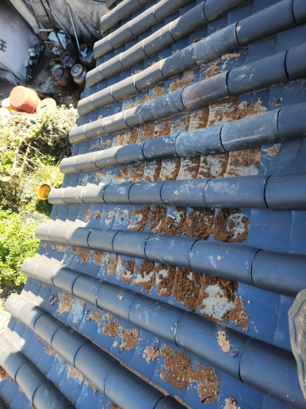
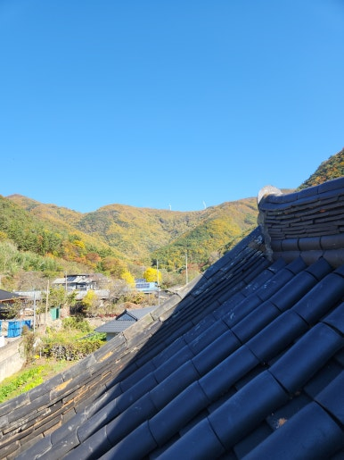

지붕 기와는 강한 바람이나 외부 충격, 노후화로 인해 깨지거나 밀리면서 누수가 발생할 수 있습니다.

이번 현장은 경북 성주군에 위치한 재실로, 지붕 상태를 점검하여 파손된 기와를 새 기와로 교체하고 지붕의 기능과 건물의 외관을 깔끔하게 복원했습니다.

---

## 🚨 기와지붕 보수가 필요한 이유

- **기와 파손 및 균열**: 기와가 깨지거나 금이 간 경우
- **기와 밀림 현상**: 강한 바람이나 외부 충격으로 기와가 밀린 경우
- **빗물 유입 차단**: 기와 사이 틈새로 빗물이 침투하는 현상 방지
- **노후 기와 파손 방지**: 약해진 기와가 추가로 파손되는 것을 예방
- **실내 누수 예방**: 비가 내린 후 천장이나 지붕 내부에 누수 흔적이 보이는 현상 차단

---

## 📌 방치하면 생기는 문제

- 빗물이 지붕 내부로 침투하여 누수 발생
- 지붕 내부 목재 및 구조물의 습기 피해
- 천장과 실내 벽면에 물 자국 및 곰팡이 발생
- 주변 기와까지 밀리거나 추가 파손될 우려
- 장기적인 수분 침투로 인한 보수 비용 증가

---

## 1. 시공 전

현장 점검 결과, 기존 기와지붕의 파손 및 균열 상태가 확인되었습니다.

빗물 유입 우려 구간과 주변 기와 상태를 사전에 꼼꼼하게 체크했습니다.

| :---: | :---: |
|  |  |

---

## 2. 시공 중

안전 장비를 착용하고 작업 구역을 확보한 뒤, 파손된 기와 철거 및 새 기와 교체 작업을 차근차근 진행했습니다.

1. **현장 상태 점검**: 기와지붕 전체와 파손 부위 확인
2. **손상 기와 확인**: 깨지거나 균열이 발생한 기와 선별
3. **파손 기와 제거**: 주변 기와 손상 없이 깨진 기와 철거
4. **새 기와 교체**: 기존 지붕 형태에 맞춰 새 기와 설치
5. **마감 및 최종 점검**: 기와 배열과 고정 상태 꼼꼼하게 확인

---

## 3. 시공 후

경북 성주군 재실 기와지붕 깨진 기와 교체 작업을 성공적으로 마무리했습니다.

파손된 기와 제거 및 새 기와 교체를 완료하고 주변 기와 배열과 지붕 마감 상태까지 정돈하여 비가 와도 빗물이 실내로 유입되지 않도록 환경을 조성했습니다.

| :---: | :---: |
|  |  |

---

## 📣 이럴 때 보수를 고려해 보세요!

- **추천 대상**: 지붕 기와가 깨지거나 금이 간 경우, 오래된 재실이나 한옥의 지붕 관리가 필요한 경우, 강풍이나 태풍 이후 기와가 밀리거나 파손된 경우, 비가 내리면 천장에 누수 흔적이 생기는 경우, 장마철을 앞두고 지붕 상태를 점검하고 싶은 경우
- **출장 가능 지역**: 성주, 대구, 구미, 김천, 경산, 경주, 포항, 안동, 창원, 김해, 진주, 울산 등 경북·경남 주요 지역 (제주 제외 전국)
- **문의 안내**: 현장 상황에 맞춘 정확한 진단과 정직·투명한 견적으로 꼭 필요한 작업만 꼼꼼하게 시공해 드립니다.

  
    Naver Blog
  

  <h3 style="margin: 0 0 10px 0; font-size: 20px; color: #1a1a1a;">
    현장 전체 시공 과정이 궁금하시다면?
  </h3>

  

    블로그에서 더 상세한 <strong style="color: #03C75A;">작업 단계별 사진과 세부 시공 팁</strong>을 확인해 보세요.
  

  <a href="https://blog.naver.com/homecare__119/224470572831"
     target="_blank"
     rel="noopener"
     style="display: inline-flex;
            align-items: center;
            justify-content: center;
            gap: 8px;
            background: #03C75A;
            color: #ffffff;
            text-decoration: none;
            padding: 14px 28px;
            border-radius: 50px;
            font-weight: 700;
            font-size: 15px;
            box-shadow: 0 4px 14px rgba(3, 199, 90, 0.35);
            transition: all 0.2s ease;">
    네이버 블로그에서 자세히 보기
    →
  </a>

<section style="background: #ffffff;
                border: 1px solid #eee;
                border-radius: 16px;
                padding: 32px 24px;
                margin-top: 40px;
                text-align: center;">

  <h2 style="margin-top: 0; margin-bottom: 16px; font-size: 22px; color: #222;">
    시공 및 견적 문의 안내
  </h2>

  

    <strong>깨진 기와 교체 및 부분 보수 · 기와 들뜸•밀림 점검 및 보수 · 재실 및 한옥 지붕 누수 점검 및 유지 보수</strong> 
    <strong>제주 제외 전국</strong> 현장 맞춤 진단 후 꼼꼼하게 시공합니다. 
    전화, 문자, 카카오톡 중 편하신 방법으로 부담 없이 문의해 주세요!
  

  

  

    현장 사진을 미리 찍어서 보내주시면 더욱 정확하고 빠른 상담이 가능합니다. 😀
  

</section>
