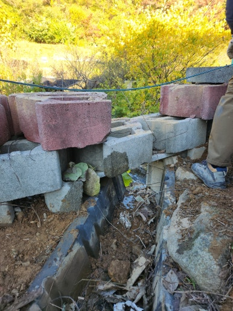
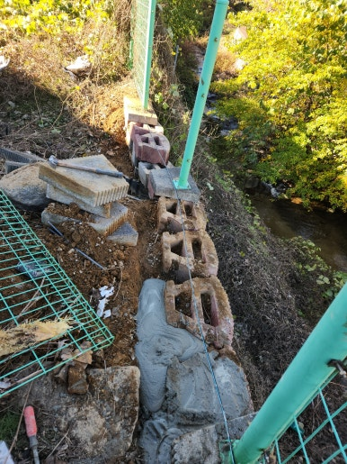
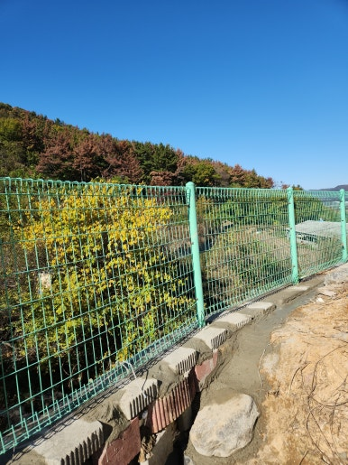
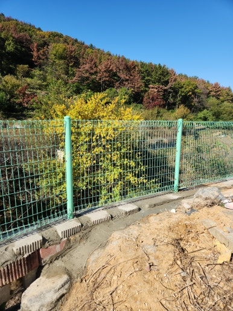

펜스는 외부 공간을 구분하고 안전을 지켜주는 중요한 시설물입니다. 하지만 외부 환경 변화와 시간의 경과, 강풍이나 외부 충격으로 인해 기둥이 흔들리거나 고정력이 약해지면 전체 구조가 불안정해질 수 있습니다.

이번 현장은 강원도 영월군에 위치한 현장으로, 흔들리는 펜스 기둥의 고정 상태를 점검하고 수직 상태를 교정하여 단단하고 안정하게 사용할 수 있도록 보수 작업을 진행했습니다.

---

## 🚨 펜스 기둥 보수가 필요한 이유

- **기둥 흔들림 현상**: 펜스 기둥을 손으로 밀었을 때 흔들리는 경우
- **하부 고정력 약화**: 기둥 하부의 고정 부위가 약해진 경우
- **기둥 기울어짐**: 강풍이나 외부 충격으로 인해 기둥이 기울어진 경우
- **기초 콘크리트 균열**: 콘크리트 기초에 균열이나 파손이 발생한 경우
- **전체 구조 불안정**: 펜스 전체가 한쪽으로 기울어지거나 불안정한 경우

---

## 📌 방치하면 생기는 문제

- 펜스 전체의 고정력 저하 및 변형 발생
- 기둥이 점점 기울어지는 현상 심화
- 연결된 펜스 패널 및 주변 부속 자재 손상
- 강풍 발생 시 펜스가 넘어지는 안전사고 위험
- 추가 파손으로 인한 보수 범위 및 비용 증가

---

## 1. 시공 전

현장 점검 결과, 기존 펜스 기둥의 흔들림 상태와 하부 고정력 저하가 확인되었습니다.

기둥 주변 기초 및 연결 부위의 상태를 꼼꼼하게 체크한 후 작업 방향을 수립했습니다.

| :---: | :---: |
|  |  |

---

## 2. 시공 중

안전 구역을 확보한 뒤 약해진 고정 부위를 정리하고 수직 교정 및 보강 작업을 차근차근 진행했습니다.

1. **현장 상태 점검**: 펜스 기둥 흔들림 및 주변 상태 확인
2. **고정 부위 확인**: 기둥 하부와 기초 손상 여부 점검
3. **기존 고정부 보수**: 약해진 고정 부분 정리 및 보강 준비
4. **기둥 고정 작업**: 기둥 수직 상태 조정 및 견고하게 고정
5. **마감 및 최종 점검**: 고정 상태와 펜스 흔들림 여부 확인

---

## 3. 시공 후

강원도 영월군 펜스 기둥 흔들림 보수 작업을 성공적으로 마무리했습니다.

흔들리던 기둥을 단단하게 고정하고 수직 교정과 주변 마감까지 깔끔하게 정리하여 안전하게 펜스를 이용하실 수 있도록 환경을 조성했습니다.

| :---: | :---: |
|  |  |

---

## 📣 이럴 때 보수를 고려해 보세요!

- **추천 대상**: 펜스 기둥이 좌우로 흔들리는 경우, 오래된 펜스의 기초 고정력이 약해진 경우, 태풍이나 강풍 이후 기둥이 기울어진 경우, 기둥 주변 콘크리트가 깨지거나 갈라진 경우, 펜스가 전체적으로 불안정해 보이는 경우
- **출장 가능 지역**: 영월, 정선, 평창, 태백, 삼척, 대구, 경산, 경주, 포항, 영천, 안동, 김천, 구미, 성주, 문경, 상주, 창원, 김해, 진주, 울산 등 경북·경남·강원 주요 지역 (제주 제외 전국)
- **문의 안내**: 현장 상황에 맞춘 정확한 진단과 정직·투명한 견적으로 꼭 필요한 작업만 꼼꼼하게 시공해 드립니다.

  
    Naver Blog
  

  <h3 style="margin: 0 0 10px 0; font-size: 20px; color: #1a1a1a;">
    현장 전체 시공 과정이 궁금하시다면?
  </h3>

  

    블로그에서 더 상세한 <strong style="color: #03C75A;">작업 단계별 사진과 세부 시공 팁</strong>을 확인해 보세요.
  

  <a href="https://blog.naver.com/homecare__119/224471495244"
     target="_blank"
     rel="noopener"
     style="display: inline-flex;
            align-items: center;
            justify-content: center;
            gap: 8px;
            background: #03C75A;
            color: #ffffff;
            text-decoration: none;
            padding: 14px 28px;
            border-radius: 50px;
            font-weight: 700;
            font-size: 15px;
            box-shadow: 0 4px 14px rgba(3, 199, 90, 0.35);
            transition: all 0.2s ease;">
    네이버 블로그에서 자세히 보기
    →
  </a>

<section style="background: #ffffff;
                border: 1px solid #eee;
                border-radius: 16px;
                padding: 32px 24px;
                margin-top: 40px;
                text-align: center;">

  <h2 style="margin-top: 0; margin-bottom: 16px; font-size: 22px; color: #222;">
    시공 및 견적 문의 안내
  </h2>

  

    <strong>흔들리는 펜스 기둥 고정 및 보수 · 기울어진 펜스 기둥 수직 교정 · 펜스 기둥 하부 및 기초 보강 · 펜스 연결 부위 점검 및 유지 보수</strong> 
    <strong>제주 제외 전국</strong> 현장 맞춤 진단 후 꼼꼼하게 시공합니다. 
    전화, 문자, 카카오톡 중 편하신 방법으로 부담 없이 문의해 주세요!
  

  

  

    현장 사진을 미리 찍어서 보내주시면 더욱 정확하고 빠른 상담이 가능합니다. 😀
  

</section>
