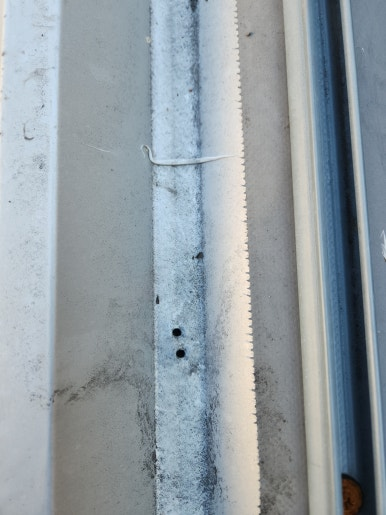
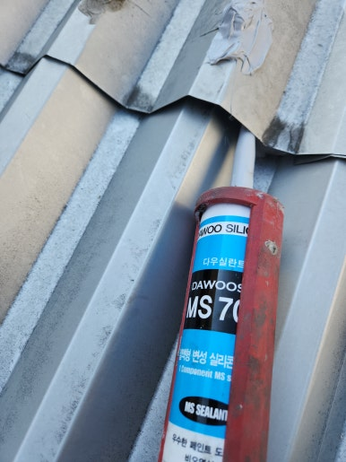
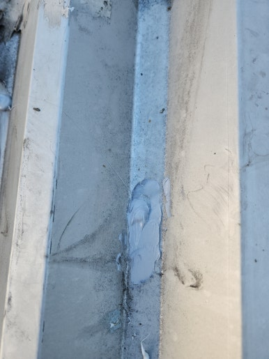
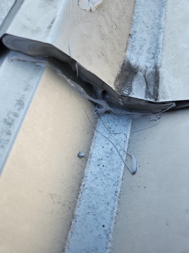

판넬지붕은 실리콘 노후화, 고정 피스 부식, 연결 부위 틈새 등으로 누수가 발생할 수 있습니다.

판넬지붕은 작은 틈이나 균열로도 누수가 반복될 수 있으며, 방치할 경우 내부 철재 및 구조물의 부식과 곰팡이 발생 등 추가적인 피해로 이어질 수 있습니다.

따라서 누수가 의심된다면 초기에 정확한 원인을 확인하고 문제가 커지기 전에 적절한 보수와 방수 작업을 진행하는 것이 중요합니다.

이번 현장은 울산시 북구로, 누수 원인을 꼼꼼히 확인하고 빗물 유입을 막기 위한 판넬지붕 누수 수리 작업을 진행해 드렸습니다.

---

## 판넬지붕 누수를 방치하면 생기는 문제

- **실내 천장 및 벽면 누수 자국 발생**: 스며든 빗물로 인한 실내 얼룩 생성
- **지붕 내부 철재 및 구조물 부식**: 습기로 인한 지붕 골조 및 철재 손상
- **습기 증가와 곰팡이 발생**: 쾌적하지 못한 실내 환경 유발
- **전기 설비 및 내부 마감재 손상 위험**: 누수로 인한 설비 고장 및 내구성 저하
- **추가 수리 비용 증가**: 누수 범위 확대에 따른 공사 규모 증대

---

## 1. 시공 전

현장 점검 결과, 울산시 북구 판넬지붕의 연결 부위와 고정 피스 주변 누수 흔적이 확인되었습니다.

기존 방수재의 노후화 및 틈새 상태를 정확히 진단한 후 안전하게 작업을 준비했습니다.

| :---: | :---: |
|  |  |

---

## 2. 시공 중

빗물 유입을 완벽히 차단하고 방수 성능을 최대로 끌어올리는 데 중점을 두고 시공을 진행했습니다.

1. **현장 상태 점검**: 판넬지붕 전체 및 누수 의심 부위 확인
2. **누수 원인 확인**: 판넬 이음새와 고정 피스 주변 점검
3. **보수 부위 정리**: 기존 노후 방수재와 이물질 제거
4. **방수 보수 작업**: 누수 발생 부위 꼼꼼하게 방수 처리
5. **마감 및 최종 점검**: 보수 상태와 주변 마감 상태 확인

---

## 3. 시공 후

누수 의심 부위의 방수 보수 작업과 주변 마감 정리 작업을 모두 마쳤습니다.

이물질 없이 깔끔하게 방수 처리가 완료되어 더 이상 빗물이 스며들지 않는 안전한 지붕으로 탈바꿈했습니다.

| :---: | :---: |
|  |  |

---

## 이런 분들께 추천합니다!

- **추천 대상**: 비가 올 때마다 천장에서 물이 떨어지거나 판넬 이음새·고정 피스 주변으로 물이 스며드는 분, 기존 실리콘·방수재가 갈라져 오래된 판넬지붕 방수 상태가 걱정되는 분
- **출장 가능 지역**: 제주 제외 전국
- **문의 안내**: 정직하고 투명한 현장 맞춤 진단과 합리적인 견적으로 꼼꼼하게 시공해 드립니다.

  
    Naver Blog
  

  <h3 style="margin: 0 0 10px 0; font-size: 20px; color: #1a1a1a;">
    현장 전체 시공 과정이 궁금하시다면?
  </h3>

  

    블로그에서 더 상세한 <strong style="color: #03C75A;">작업 단계별 사진과 세부 시공 팁</strong>을 확인해 보세요.
  

  <a href="https://blog.naver.com/homecare__119/224474410780"
     target="_blank"
     rel="noopener"
     style="display: inline-flex;
            align-items: center;
            justify-content: center;
            gap: 8px;
            background: #03C75A;
            color: #ffffff;
            text-decoration: none;
            padding: 14px 28px;
            border-radius: 50px;
            font-weight: 700;
            font-size: 15px;
            box-shadow: 0 4px 14px rgba(3, 199, 90, 0.35);
            transition: all 0.2s ease;">
    네이버 블로그에서 자세히 보기
    →
  </a>

<section style="background: #ffffff;
                border: 1px solid #eee;
                border-radius: 16px;
                padding: 32px 24px;
                margin-top: 40px;
                text-align: center;">

  <h2 style="margin-top: 0; margin-bottom: 16px; font-size: 22px; color: #222;">
    시공 및 견적 문의 안내
  </h2>

  

    <strong>판넬지붕 누수 방수 · 지붕 보수 및 부분 방수</strong> 
    <strong>제주 제외 전국</strong> 현장 맞춤 진단 후 꼼꼼하게 시공합니다. 
    전화, 문자, 카카오톡 중 편하신 방법으로 부담 없이 문의해 주세요!
  

  

  

    현장 사진을 미리 찍어서 보내주시면 더욱 정확하고 빠른 상담이 가능합니다. 😀
  

</section>
