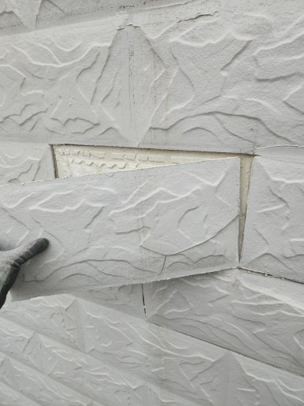
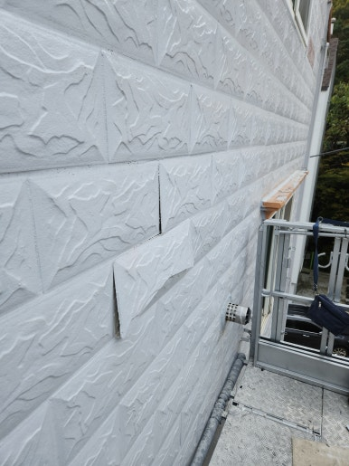
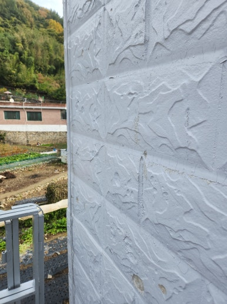
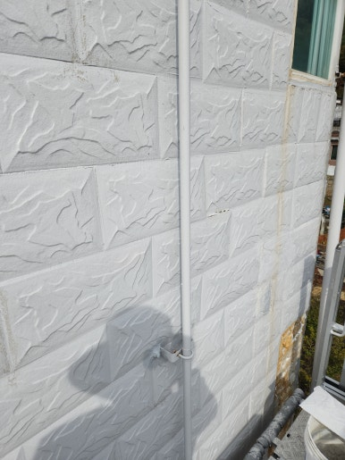

외부 환경에 장기간 노출된 외벽 타일은 온도 변화, 빗물, 습기 등으로 인해 접착력이 약해지면서 들뜨거나 떨어질 수 있습니다.

외벽 타일은 건물 보호와 외관 유지에 중요한 마감재이므로, 들뜸이나 이탈 상태를 방치할 경우 낙하 사고 등 안전 문제로 이어질 수 있습니다.

따라서 이상 징후를 발견했다면 초기에 정확한 상태를 점검하고 문제가 커지기 전에 적절한 보수 작업을 진행하는 것이 중요합니다.

이번 현장은 경남 창원시로, 타일의 들뜸과 이탈 상태를 꼼꼼히 확인하고 안전하고 깔끔하게 외벽 타일 보수 작업을 진행해 드렸습니다.

---

## 외벽 타일 들뜸·이탈을 방치하면 생기는 문제

- **타일 탈락으로 인한 안전사고 위험**: 들뜬 타일이 떨어지면서 발생하는 보행자 및 시설물 피해 우려
- **빗물 유입으로 인한 외벽 내부 습기 발생**: 틈새로 스며든 수분으로 인한 건물 내부 손상
- **기존 타일 주변으로 들뜸 현상 확대**: 인접한 타일까지 접착력이 약화되어 손상 범위 확산
- **건물 외관 훼손 및 미관 저하**: 갈라진 줄눈과 탈락 부위로 인한 노후화 가속
- **추가 수리 비용 증가**: 보수 범위 확대에 따른 공사 규모 증대

---

## 1. 시공 전

현장 점검 결과, 경남 창원시 건물 외벽 타일의 들뜸 및 이탈 흔적과 주변 줄눈 손상 상태가 확인되었습니다.

손상 부위와 인접 타일의 접착 상태를 정확히 진단한 후 안전하게 작업을 준비했습니다.

| :---: | :---: |
|  |  |

---

## 2. 시공 중

타일 탈락 위험을 원천 차단하고 기존 외벽과 조화롭게 마감하는 데 중점을 두고 시공을 진행했습니다.

1. **현장 상태 점검**: 외벽 타일 들뜸 및 이탈 부위 확인
2. **손상 부위 정리**: 들뜬 타일과 불량 마감재 제거
3. **바탕면 정리**: 기존 접착 잔여물 및 이물질 제거
4. **타일 보수 작업**: 바탕면 상태에 맞춰 타일 재부착 및 보수
5. **마감 및 최종 점검**: 줄눈과 주변 마감 상태 확인

---

## 3. 시공 후

손상된 외벽 타일의 재부착 보수 작업과 주변 줄눈 및 마감 정리 작업을 모두 마쳤습니다.

주변 타일과 이질감 없이 깔끔하게 보수가 완료되어 안전하고 단정한 건물 외벽으로 탈바꿈했습니다.

| :---: | :---: |
|  |  |

---

## 이런 분들께 추천합니다!

- **추천 대상**: 건물 외벽 타일이 벽면에서 튀어나오거나 들떠 있는 분, 타일 일부가 탈락했거나 두드렸을 때 빈 소리가 나는 분, 외벽 줄눈이 갈라져 노후 건물의 외벽 안전이 걱정되는 분
- **출장 가능 지역**: 제주 제외 전국
- **문의 안내**: 정직하고 투명한 현장 맞춤 진단과 합리적인 견적으로 꼼꼼하게 시공해 드립니다.

  
    Naver Blog
  

  <h3 style="margin: 0 0 10px 0; font-size: 20px; color: #1a1a1a;">
    현장 전체 시공 과정이 궁금하시다면?
  </h3>

  

    블로그에서 더 상세한 <strong style="color: #03C75A;">작업 단계별 사진과 세부 시공 팁</strong>을 확인해 보세요.
  

  <a href="https://blog.naver.com/homecare__119/224475388085"
     target="_blank"
     rel="noopener"
     style="display: inline-flex;
            align-items: center;
            justify-content: center;
            gap: 8px;
            background: #03C75A;
            color: #ffffff;
            text-decoration: none;
            padding: 14px 28px;
            border-radius: 50px;
            font-weight: 700;
            font-size: 15px;
            box-shadow: 0 4px 14px rgba(3, 199, 90, 0.35);
            transition: all 0.2s ease;">
    네이버 블로그에서 자세히 보기
    →
  </a>

<section style="background: #ffffff;
                border: 1px solid #eee;
                border-radius: 16px;
                padding: 32px 24px;
                margin-top: 40px;
                text-align: center;">

  <h2 style="margin-top: 0; margin-bottom: 16px; font-size: 22px; color: #222;">
    시공 및 견적 문의 안내
  </h2>

  

    <strong>건물 외벽 들뜬 타일 보수 · 이탈 타일 복구 및 줄눈 보수</strong> 
    <strong>제주 제외 전국</strong> 현장 맞춤 진단 후 꼼꼼하게 시공합니다. 
    전화, 문자, 카카오톡 중 편하신 방법으로 부담 없이 문의해 주세요!
  

  

  

    현장 사진을 미리 찍어서 보내주시면 더욱 정확하고 빠른 상담이 가능합니다. 😀
  

</section>
