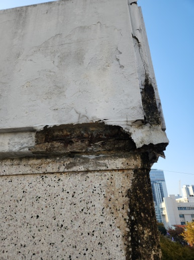
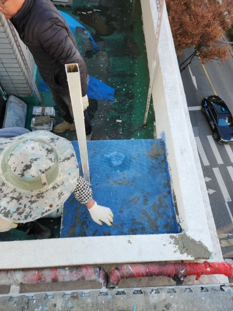
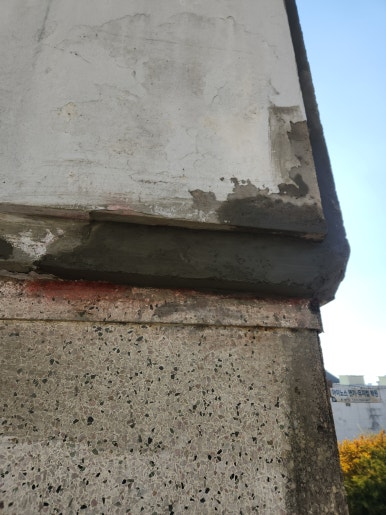
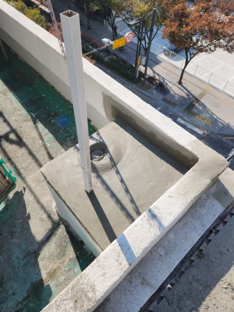

비바람과 온도 변화, 습기 등 외부 환경에 장기간 노출된 건물 외벽은 시간이 지나면서 균열이 생기거나 일부 파손될 수 있습니다.

건물 외벽은 건물의 첫인상을 결정하는 중요한 요소이자 외부 환경으로부터 건물을 보호하는 역할을 하므로, 작은 파손이라도 방치할 경우 주변 마감재까지 손상이 확산될 수 있습니다.

따라서 이상 징후를 발견했다면 초기에 정확한 상태를 점검하고 문제가 커지기 전에 적절한 보수 작업을 진행하는 것이 중요합니다.

이번 현장은 울산 북구로, 외벽 파손 부위를 꼼꼼히 확인하고 추가 손상을 방지하며 외관을 개선할 수 있도록 깔끔하고 튼튼하게 외벽 보수 작업을 진행해 드렸습니다.

---

## 외벽 파손을 방치하면 생기는 문제

- **파손 부위 확대 및 주변 마감재 손상**: 작은 균열과 깨짐이 주변 외벽까지 번져 손상 범위 확산
- **빗물 유입으로 인한 외벽 내부 습기 발생**: 파손된 틈새로 스며든 수분으로 인한 건물 내부 손상
- **외벽 마감재 추가 탈락 위험**: 손상 부위에서 마감재가 떨어져 나가며 발생하는 주변 통행 안전 위협
- **건물 외관 훼손 및 미관 저하**: 노출된 바탕면과 파손 부위로 인한 건물 노후화 가속
- **보수 비용 증가**: 손상 범위가 넓어짐에 따라 커지는 공사 규모와 수리 비용

---

## 1. 시공 전

현장 점검 결과, 울산 북구 건물 외벽 일부의 파손 및 마감재 손상 상태가 확인되었습니다.

손상 부위와 주변 외벽 상태를 정확히 진단한 후 안전하게 작업을 준비했습니다.

| :---: | :---: |
|  |  |

---

## 2. 시공 중

추가적인 탈락 위험을 원천 차단하고 기존 외벽과 조화롭게 마감하는 데 중점을 두고 시공을 진행했습니다.

1. **현장 상태 점검**: 외벽 파손 부위 및 주변 손상 상태 확인
2. **파손 부위 정리**: 손상된 마감재와 불량 부분 제거
3. **바탕면 정리**: 이물질 및 잔여물 제거 후 바탕면 정돈
4. **외벽 보수 작업**: 파손 부위 충전 및 보수재 시공
5. **마감 및 최종 점검**: 주변 마감 정리 및 보수 상태 확인

---

## 3. 시공 후

파손된 외벽 부위의 충전 보수 작업과 주변 마감 정리 작업을 모두 마쳤습니다.

주변 외벽과 이질감 없이 깔끔하게 복구가 완료되어 안전하고 단정한 건물 외관으로 탈바꿈했습니다.

| :---: | :---: |
|  |  |

---

## 이런 분들께 추천합니다!

- **추천 대상**: 건물 외벽 일부가 깨지거나 파손된 분, 외벽 마감재가 떨어져 나가거나 표면에 균열이 발생한 분, 노후 건물의 외벽 파손으로 빗물 유입 및 안전이 걱정되는 분
- **출장 가능 지역**: 제주 제외 전국
- **문의 안내**: 정직하고 투명한 현장 맞춤 진단과 합리적인 견적으로 꼼꼼하게 시공해 드립니다.

  
    Naver Blog
  

  <h3 style="margin: 0 0 10px 0; font-size: 20px; color: #1a1a1a;">
    현장 전체 시공 과정이 궁금하시다면?
  </h3>

  

    블로그에서 더 상세한 <strong style="color: #03C75A;">작업 단계별 사진과 세부 시공 팁</strong>을 확인해 보세요.
  

  <a href="https://blog.naver.com/homecare__119/224476687860"
     target="_blank"
     rel="noopener"
     style="display: inline-flex;
            align-items: center;
            justify-content: center;
            gap: 8px;
            background: #03C75A;
            color: #ffffff;
            text-decoration: none;
            padding: 14px 28px;
            border-radius: 50px;
            font-weight: 700;
            font-size: 15px;
            box-shadow: 0 4px 14px rgba(3, 199, 90, 0.35);
            transition: all 0.2s ease;">
    네이버 블로그에서 자세히 보기
    →
  </a>

<section style="background: #ffffff;
                border: 1px solid #eee;
                border-radius: 16px;
                padding: 32px 24px;
                margin-top: 40px;
                text-align: center;">

  <h2 style="margin-top: 0; margin-bottom: 16px; font-size: 22px; color: #222;">
    시공 및 견적 문의 안내
  </h2>

  

    <strong>건물 외벽 파손 부위 보수 · 손상된 마감재 복구 및 균열·깨짐 보수</strong> 
    <strong>제주 제외 전국</strong> 현장 맞춤 진단 후 꼼꼼하게 시공합니다. 
    전화, 문자, 카카오톡 중 편하신 방법으로 부담 없이 문의해 주세요!
  

  

  

    현장 사진을 미리 찍어서 보내주시면 더욱 정확하고 빠른 상담이 가능합니다. 😀
  

</section>
