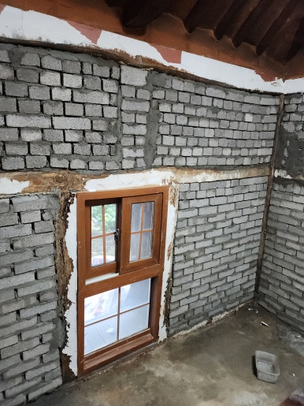
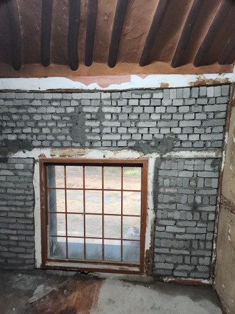
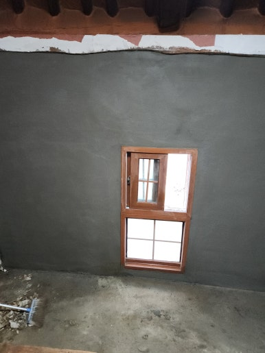
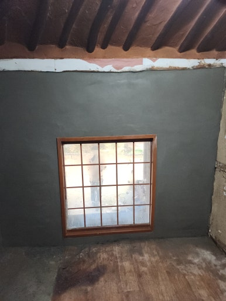

노후된 기존 흙벽을 대신해 벽돌로 새롭게 조적한 한옥 내부 벽체는 표면의 거친 줄눈과 굴곡이 그대로 노출되어 있어 깔끔한 마감을 위한 미장 작업이 필수적입니다.

조적 벽체 위에 빈틈과 굴곡을 메우는 시멘트 미장 작업은 단순히 시멘트를 바르는 과정이 아니라, 바탕면을 꼼꼼히 정리하고 일정한 두께로 평탄화하여 전체적인 공간의 완성도와 내구성을 높이는 중요한 공정입니다.

특히 한옥 내부의 경우 기존 구조와 새로운 벽체가 이질감 없이 자연스럽게 어우러지도록 세심하게 마감하는 것이 중요합니다.

이번 현장은 경북 경주시 소재의 한옥으로, 벽돌 조적이 완료된 내부 벽체의 상태를 면밀히 점검한 뒤 시멘트 모르타르를 도포하여 벽면 전체를 매끄럽고 단단하게 마감해 드렸습니다.

---

## 벽돌 조적 후 미장 작업이 중요한 이유

- **실내 미관 저하 방지**: 벽돌과 줄눈이 그대로 노출되어 어수선해 보이는 내부 공간 개선
- **마감 품질 향상**: 벽면의 굴곡과 빈틈을 고르게 정리하여 균일한 벽체 완성
- **후속 작업 용이성 확보**: 거친 표면을 매끄럽게 평탄화하여 이후 도장이나 추가 마감 작업 수월
- **추가 보수 위험 예방**: 미장면의 불균형으로 발생할 수 있는 들뜸이나 균열 사전에 차단
- **공간 분위기 조화**: 깔끔하게 정돈된 벽면 마감을 통해 한옥 내부의 전체적인 분위기 개선

---

## 1. 시공 전

현장 점검 결과, 경북 경주시 한옥 내부의 기존 흙벽을 대신해 벽돌 조적 작업이 완료된 상태였으며 벽돌 표면과 줄눈이 그대로 노출되어 있었습니다.

벽돌 조적 상태와 벽면의 굴곡을 정확히 확인한 후 깔끔한 평탄화 작업을 준비했습니다.

| :---: | :---: |
|  |  |

---

## 2. 시공 중

기존 한옥 구조와 자연스럽게 어우러지면서도 균일하고 매끄러운 벽면을 완성하는 데 중점을 두고 시공을 진행했습니다.

1. **현장 상태 점검**: 벽돌 조적 상태 및 벽면 굴곡 확인
2. **바탕면 정리**: 벽돌 표면의 먼지 및 이물질 제거
3. **미장 준비 작업**: 벽체 상태 재확인 및 모르타르 시공 준비
4. **시멘트 미장 작업**: 시멘트 모르타르 도포 및 벽면 전체 평탄화
5. **마감 및 최종 점검**: 미장면 표면 정리 및 최종 마감 상태 확인

---

## 3. 시공 후

벽돌 조적 벽체 전체에 시멘트 미장 작업과 표면 정리 작업을 모두 마쳤습니다.

거칠었던 벽돌과 줄눈이 고르게 정리되어 한옥 내부 공간이 한층 깔끔하고 단정한 모습으로 탈바꿈했습니다.

| :---: | :---: |
|  |  |

---

## 이런 분들께 추천합니다!

- **추천 대상**: 기존 흙벽을 벽돌로 새롭게 조적하신 분, 벽돌 사이 줄눈과 거친 표면이 노출되어 깔끔한 마감이 필요하신 분, 한옥 내부 벽체 평탄화 및 도장 등 후속 마감 공사를 준비하시는 분
- **출장 가능 지역**: 제주 제외 전국
- **문의 안내**: 정직하고 투명한 현장 맞춤 진단과 합리적인 견적으로 꼼꼼하게 시공해 드립니다.

  
    Naver Blog
  

  <h3 style="margin: 0 0 10px 0; font-size: 20px; color: #1a1a1a;">
    현장 전체 시공 과정이 궁금하시다면?
  </h3>

  

    블로그에서 더 상세한 <strong style="color: #03C75A;">작업 단계별 사진과 세부 시공 팁</strong>을 확인해 보세요.
  

  <a href="https://blog.naver.com/homecare__119/224477640543"
     target="_blank"
     rel="noopener"
     style="display: inline-flex;
            align-items: center;
            justify-content: center;
            gap: 8px;
            background: #03C75A;
            color: #ffffff;
            text-decoration: none;
            padding: 14px 28px;
            border-radius: 50px;
            font-weight: 700;
            font-size: 15px;
            box-shadow: 0 4px 14px rgba(3, 199, 90, 0.35);
            transition: all 0.2s ease;">
    네이버 블로그에서 자세히 보기
    →
  </a>

<section style="background: #ffffff;
                border: 1px solid #eee;
                border-radius: 16px;
                padding: 32px 24px;
                margin-top: 40px;
                text-align: center;">

  <h2 style="margin-top: 0; margin-bottom: 16px; font-size: 22px; color: #222;">
    시공 및 견적 문의 안내
  </h2>

  

    <strong>기존 흙벽 철거 후 벽돌 조적 벽체 미장 · 벽돌 조적면 시멘트 미장 및 평탄화</strong> 
    <strong>제주 제외 전국</strong> 현장 맞춤 진단 후 꼼꼼하게 시공합니다. 
    전화, 문자, 카카오톡 중 편하신 방법으로 부담 없이 문의해 주세요!
  

  

  

    현장 사진을 미리 찍어서 보내주시면 더욱 정확하고 빠른 상담이 가능합니다. 😀
  

</section>
