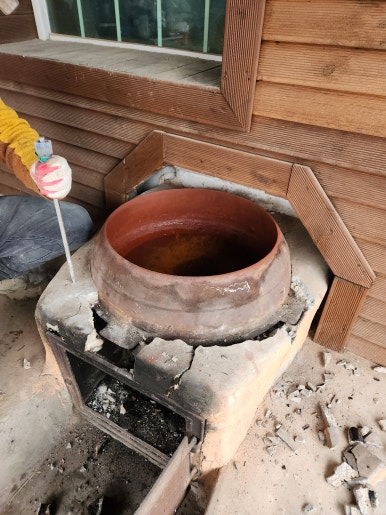
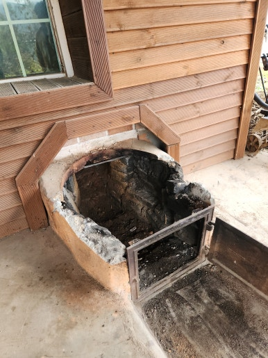
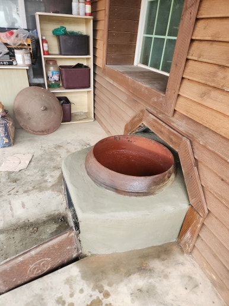
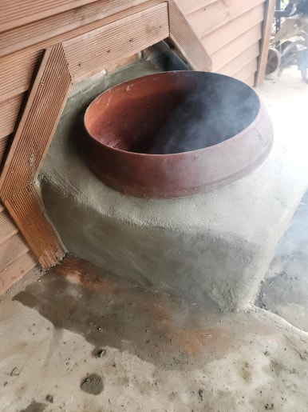

오랜 사용으로 고온과 반복적인 열 변화에 노출된 아궁이는 주변 벽체와 바닥에 균열이 생기거나 시멘트 마감이 깨져 떨어지는 손상이 발생하기 쉽습니다.

아궁이 보수 작업은 단순히 깨진 틈을 메우는 과정이 아니라, 기존 아궁이의 구조와 손상 상태를 꼼꼼히 확인한 뒤 사용 환경에 맞는 내열성 자재를 적용해 내구성과 안전성을 높이는 중요한 공정입니다.

특히 갈라진 틈새를 그대로 방치할 경우 연기나 열기가 새어 나오거나 파손 범위가 점점 넓어질 수 있어 초기 상태에 맞춘 세심한 보수가 필요합니다.

이번 현장은 경북 성주군 소재로, 깨지고 들뜬 손상 부위를 말끔히 정리한 뒤 균열 보강 및 표면 미장 마감 작업을 통해 튼튼하고 단정하게 복원해 드렸습니다.

---

## 아궁이 보수 작업이 중요한 이유

- **외관 미관 개선**: 깨지고 떨어져 나간 시멘트 마감으로 지저분해 보이던 아궁이 주변 정리
- **연기 및 열기 누출 차단**: 균열과 갈라진 틈새를 꼼꼼히 메워 불을 지필 때 발생하는 연기·열기 유출 방지
- **추가 파손 확산 예방**: 미세 균열이나 들뜬 부위가 열기에 의해 더 넓게 부서지는 현상 사전에 차단
- **구조적 내구성 강화**: 고온 환경에 적합한 보수 자재를 사용해 기존 아궁이 구조물의 수명 연장
- **안전한 사용 환경 조성**: 아궁이 사용 시 발생할 수 있는 안전사고 위험을 줄이고 편의성 향상

---

## 1. 시공 전

현장 점검 결과, 경북 성주군 현장의 아궁이는 오랜 사용으로 인해 벽체와 바닥 곳곳이 깨지고 갈라져 있으며 기존 시멘트 마감이 일부 떨어져 나간 상태였습니다.

손상 부위의 깊이와 균열 범위를 정확히 확인한 후 들뜬 부분을 정리하는 보수 작업을 준비했습니다.

| :---: | :---: |
|  |  |

---

## 2. 시공 중

고온의 사용 환경을 고려하여 기존 아궁이 구조를 최대한 살리면서도 튼튼하고 매끄럽게 마감하는 데 중점을 두고 시공을 진행했습니다.

1. **현장 상태 점검**: 아궁이 균열 및 파손 부위 확인
2. **손상 부위 정리**: 깨지고 들뜬 부분 제거
3. **보수 작업 준비**: 바탕면 정리 및 내열 보수 자재 준비
4. **아궁이 보수 작업**: 손상 부위 충진 및 균열 보강
5. **마감 및 최종 점검**: 표면 정리 및 최종 보수 상태 확인

---

## 3. 시공 후

파손되었던 아궁이 벽체와 바닥의 균열 보강 및 전체 표면 정리 작업을 모두 마쳤습니다.

곳곳이 깨지고 갈라져 있던 아궁이가 한층 튼튼하고 깔끔한 모습으로 보수되어 고객님께서도 만족해하셨습니다.

| :---: | :---: |
|  |  |

---

## 이런 분들께 추천합니다!

- **추천 대상**: 오래된 아궁이의 벽체나 바닥이 갈라지고 깨지신 분, 시멘트 마감이 부서져 떨어지거나 틈새로 연기·열기가 새어 나오는 분, 기존 아궁이를 최대한 살려 튼튼하게 보수하고 싶으신 분
- **출장 가능 지역**: 제주 제외 전국
- **문의 안내**: 정직하고 투명한 현장 맞춤 진단과 합리적인 견적으로 꼼꼼하게 시공해 드립니다.

  
    Naver Blog
  

  <h3 style="margin: 0 0 10px 0; font-size: 20px; color: #1a1a1a;">
    현장 전체 시공 과정이 궁금하시다면?
  </h3>

  

    블로그에서 더 상세한 <strong style="color: #03C75A;">작업 단계별 사진과 세부 시공 팁</strong>을 확인해 보세요.
  

  <a href="https://blog.naver.com/homecare__119/224478945037"
     target="_blank"
     rel="noopener"
     style="display: inline-flex;
            align-items: center;
            justify-content: center;
            gap: 8px;
            background: #03C75A;
            color: #ffffff;
            text-decoration: none;
            padding: 14px 28px;
            border-radius: 50px;
            font-weight: 700;
            font-size: 15px;
            box-shadow: 0 4px 14px rgba(3, 199, 90, 0.35);
            transition: all 0.2s ease;">
    네이버 블로그에서 자세히 보기
    →
  </a>

<section style="background: #ffffff;
                border: 1px solid #eee;
                border-radius: 16px;
                padding: 32px 24px;
                margin-top: 40px;
                text-align: center;">

  <h2 style="margin-top: 0; margin-bottom: 16px; font-size: 22px; color: #222;">
    시공 및 견적 문의 안내
  </h2>

  

    <strong>깨지고 갈라진 아궁이 균열 보수 · 노후 아궁이 벽체 및 바닥 미장 마감</strong> 
    <strong>제주 제외 전국</strong> 현장 맞춤 진단 후 꼼꼼하게 시공합니다. 
    전화, 문자, 카카오톡 중 편하신 방법으로 부담 없이 문의해 주세요!
  

  

  

    현장 사진을 미리 찍어서 보내주시면 더욱 정확하고 빠른 상담이 가능합니다. 😀
  

</section>
