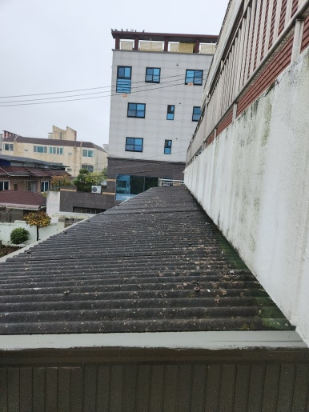
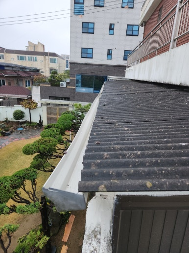
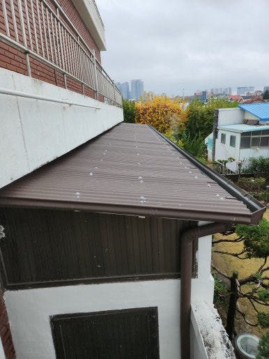
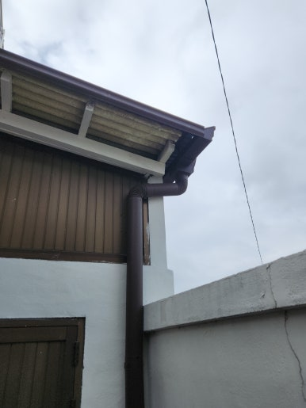

오랜 세월 비바람과 햇빛에 노출된 슬레이트 지붕은 노후화로 인해 외관이 지저분해지거나 균열·파손이 발생하기 쉽고, 빗물받이 역시 부식되어 배수 문제가 생길 수 있습니다.

칼라강판 덧씌우기 작업은 기존 지붕을 무리하게 철거하지 않고 구조적 안전성과 시공 가능 여부를 꼼꼼히 확인한 뒤, 그 위에 새로운 칼라강판을 설치하여 지붕의 내구성과 외관을 동시에 개선하는 효과적인 시공 방식입니다.

특히 슬레이트 지붕의 경우 석면 함유 여부와 기존 지붕의 하중 및 상태를 사전에 정확히 진단하는 것이 무엇보다 중요합니다.

이번 현장은 울산시 북구 소재 주택으로, 노후된 슬레이트 지붕 위 칼라강판 덧씌우기 시공과 함께 오래된 빗물받이까지 새 제품으로 교체하여 튼튼하고 깔끔하게 마감해 드렸습니다.

---

## 노후 슬레이트 지붕 및 빗물받이 정비가 중요한 이유

- **주택 외관 개선**: 오랜 세월 빛바래고 지저분해진 슬레이트 지붕을 깔끔한 칼라강판으로 새롭게 단장
- **누수 및 균열 걱정 해소**: 기존 지붕의 노후화와 연결 부위 틈새로 인한 빗물 유입 위험 사전 차단
- **석면 및 구조 안전 점검**: 시공 전 슬레이트 지붕의 석면 함유 여부와 바탕 상태를 확인해 안전한 보수 진행
- **원활한 빗물 배수 환경 조성**: 부식되고 파손된 빗물받이를 새것으로 교체해 장마철 및 우천 시 배수 효율 극대화
- **지붕 및 배수시설 통합 관리**: 지붕과 빗물받이를 함께 정비하여 향후 유지·관리 편의성과 건물 수명 향상

---

## 1. 시공 전

현장 점검 결과, 울산시 북구 현장의 주택은 오랜 세월 비바람을 맞으며 슬레이트 지붕 전체가 노후화되어 있었고, 기존 빗물받이 역시 낡아 전체적인 정비가 시급한 상태였습니다.

기존 지붕의 구조적 안전성과 석면 유무, 칼라강판 설치 가능 여부를 면밀히 확인한 후 본격적인 지붕 정비 작업을 준비했습니다.

| :---: | :---: |
|  |  |

---

## 2. 시공 중

기존 지붕 구조를 안정적으로 활용하면서 연결 부위와 용마루 마감, 빗물 배수 라인까지 빈틈없이 시공하는 데 중점을 두고 작업을 진행했습니다.

1. **현장 상태 점검**: 기존 슬레이트 지붕(석면 유무 포함) 및 빗물받이 노후 상태 확인
2. **지붕 바탕 정비**: 기존 지붕 구조의 안전성 및 칼라강판 설치 가능 여부 점검
3. **칼라강판 설치**: 기존 지붕 위에 튼튼한 새 칼라강판 덧씌우기 시공
4. **지붕 마감 작업**: 지붕 연결 부위 및 용마루 등 누수 방지를 위한 꼼꼼한 마감
5. **빗물받이 교체**: 새로운 빗물받이 설치 및 전체 시공 상태 최종 점검

---

## 3. 시공 후

노후되었던 슬레이트 지붕 위 칼라강판 덧씌우기와 빗물받이 교체 및 전체 마감 작업을 모두 마쳤습니다.

낡고 지저분하던 지붕과 배수 시설이 깔끔하고 견고하게 탈바꿈하여 고객님께서도 집이 한결 튼튼해 보인다며 매우 만족해하셨습니다.

| :---: | :---: |
|  |  |

---

## 이런 분들께 추천합니다!

- **추천 대상**: 오래된 슬레이트 지붕의 노후화로 외관 개선과 보수가 필요하신 분, 기존 지붕을 살리면서 칼라강판 덧씌우기 시공을 고려 중이신 분, 부식되거나 파손된 빗물받이를 지붕과 함께 깔끔하게 교체하고 싶으신 분
- **출장 가능 지역**: 제주 제외 전국
- **문의 안내**: 정직하고 투명한 현장 맞춤 진단과 합리적인 견적으로 꼼꼼하게 시공해 드립니다.

  
    Naver Blog
  

  <h3 style="margin: 0 0 10px 0; font-size: 20px; color: #1a1a1a;">
    현장 전체 시공 과정이 궁금하시다면?
  </h3>

  

    블로그에서 더 상세한 <strong style="color: #03C75A;">작업 단계별 사진과 세부 시공 팁</strong>을 확인해 보세요.
  

  <a href="https://blog.naver.com/homecare__119/224480296307"
     target="_blank"
     rel="noopener"
     style="display: inline-flex;
            align-items: center;
            justify-content: center;
            gap: 8px;
            background: #03C75A;
            color: #ffffff;
            text-decoration: none;
            padding: 14px 28px;
            border-radius: 50px;
            font-weight: 700;
            font-size: 15px;
            box-shadow: 0 4px 14px rgba(3, 199, 90, 0.35);
            transition: all 0.2s ease;">
    네이버 블로그에서 자세히 보기
    →
  </a>

<section style="background: #ffffff;
                border: 1px solid #eee;
                border-radius: 16px;
                padding: 32px 24px;
                margin-top: 40px;
                text-align: center;">

  <h2 style="margin-top: 0; margin-bottom: 16px; font-size: 22px; color: #222;">
    시공 및 견적 문의 안내
  </h2>

  

    <strong>노후 슬레이트 지붕 정비 · 칼라강판 덧씌우기 · 오래된 빗물받이 교체</strong> 
    <strong>제주 제외 전국</strong> 현장 맞춤 진단 후 꼼꼼하게 시공합니다. 
    전화, 문자, 카카오톡 중 편하신 방법으로 부담 없이 문의해 주세요!
  

  

  

    현장 사진을 미리 찍어서 보내주시면 더욱 정확하고 빠른 상담이 가능합니다. 😀
  

</section>
