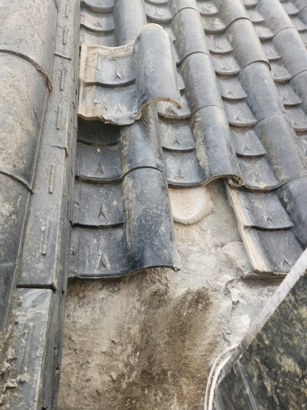
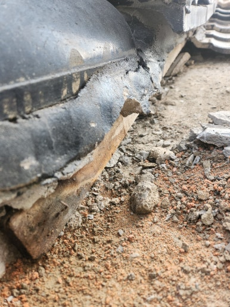
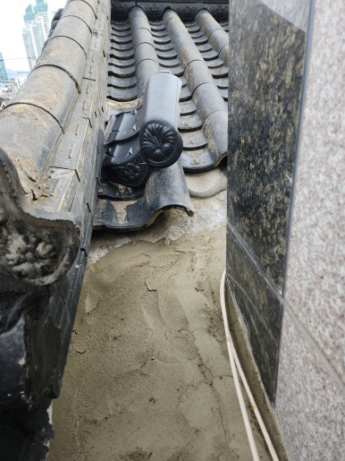
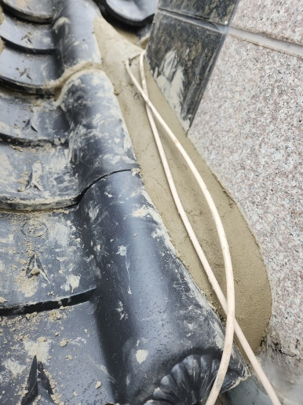

오랜 시간 비바람과 햇빛에 노출된 기와지붕은 노후화로 인해 기와가 깨지거나 밀려 틈이 생기기 쉽고, 작은 균열과 틈새를 통해 빗물이 유입되면서 실내 누수 문제로 이어질 수 있습니다.

지붕 누수는 단순히 물이 새는 부분만 막는다고 완벽하게 해결되지 않으며, 정확한 누수 원인을 진단하고 손상된 기와와 주변 연결 부위까지 함께 점검·보수해야 재발 가능성을 줄일 수 있습니다.

특히 노후 기와지붕을 방치할 경우 지붕 내부 목재 부식과 구조물 손상, 천장·벽지 곰팡이, 강풍 시 기와 탈락 등 더 큰 피해로 번질 수 있어 초기 보수가 중요합니다.

이번 현장은 경북 안동시 소재 주택으로, 노후되어 파손과 틈새가 발생한 기와지붕의 누수 원인을 꼼꼼하게 파악한 뒤 취약 부위 보수 및 지붕 마감 작업까지 안전하게 완료해 드렸습니다.

---

## 노후 기와지붕 누수 보수가 중요한 이유

- **빗물 유입 및 실내 누수 차단**: 깨지거나 어긋난 기와 틈새를 정비해 우천 시 천장이나 벽면으로 스며드는 물기 사전 차단
- **지붕 내부 목재 및 구조물 보호**: 지속적인 습기 유입으로 인한 지붕 내부 목재 부식과 천장·벽지 곰팡이 및 물 얼룩 예방
- **강풍 및 폭우 대비 안전 확보**: 들뜨거나 금이 간 기와를 단단히 고정·정비하여 악천후 시 기와 탈락 및 손상 확대 방지
- **연결 부위 정밀 마감으로 재발 방지**: 단순 부분 수리를 넘어 주변 기와와 지붕 모서리·연결 부위까지 통합 점검해 누수 재발 최소화
- **유지보수 비용 절감**: 누수 피해 범위가 넓어져 전체 지붕을 교체하기 전, 적기에 필요한 부분만 보수하여 관리 효율 극대화

---

## 1. 시공 전

현장 점검 결과, 경북 안동시 현장의 주택은 오랜 세월 비바람을 맞으며 기와지붕 전반이 노후화되어 있었고, 일부 기와의 파손 및 틈새 발생으로 인해 빗물 유입과 주택 내부 추가 손상이 우려되는 상태였습니다.

파손된 기와 위치와 정확한 누수 원인을 면밀히 확인한 후 본격적인 지붕 보수 작업을 준비했습니다.

| :---: | :---: |
|  |  |

---

## 2. 시공 중

누수 원인이 되는 취약 부위를 정확히 보강하고, 기와 연결 부위와 주변 마감까지 빈틈없이 정리하는 데 중점을 두고 작업을 진행했습니다.

1. **현장 점검**: 기존 기와지붕의 파손 상태 및 정확한 누수 발생 부위 확인
2. **손상 기와 정비**: 깨지거나 위치가 어긋난 노후 기와 정리
3. **누수 부위 보수**: 빗물이 유입되는 틈새 및 취약 부위 집중 보강 작업
4. **지붕 마감 작업**: 기와 연결 부위 및 주변 마감 라인 깔끔하게 정리
5. **최종 상태 확인**: 보수 부위 및 지붕 전체 점검으로 마감 완성도 최종 확인

---

## 3. 시공 후

노후되었던 기와지붕의 손상 부위 보수와 연결 부위 마감 작업을 모두 마쳤습니다.

깨진 기와와 틈새가 깔끔하게 정비되어 고객님께서도 이제 비가 와도 걱정이 없겠다며 꼼꼼한 작업 결과에 매우 만족해하셨습니다.

| :---: | :---: |
|  |  |

---

## 이런 분들께 추천합니다!

- **추천 대상**: 비가 올 때 지붕에서 물이 새거나 천장·벽면에 물 자국이 생기시는 분, 오래된 기와가 깨지거나 밀려 지붕 일부가 들뜨신 분, 전체 지붕 교체 없이 필요한 부위의 꼼꼼한 부분 누수 보수를 원하시는 분
- **출장 가능 지역**: 제주 제외 전국
- **문의 안내**: 정직하고 투명한 현장 맞춤 진단과 합리적인 견적으로 꼭 필요한 작업만 꼼꼼하게 시공해 드립니다.

  
    Naver Blog
  

  <h3 style="margin: 0 0 10px 0; font-size: 20px; color: #1a1a1a;">
    현장 전체 시공 과정이 궁금하시다면?
  </h3>

  

    블로그에서 더 상세한 <strong style="color: #03C75A;">작업 단계별 사진과 세부 시공 팁</strong>을 확인해 보세요.
  

  <a href="https://blog.naver.com/homecare__119/224483718941"
     target="_blank"
     rel="noopener"
     style="display: inline-flex;
            align-items: center;
            justify-content: center;
            gap: 8px;
            background: #03C75A;
            color: #ffffff;
            text-decoration: none;
            padding: 14px 28px;
            border-radius: 50px;
            font-weight: 700;
            font-size: 15px;
            box-shadow: 0 4px 14px rgba(3, 199, 90, 0.35);
            transition: all 0.2s ease;">
    네이버 블로그에서 자세히 보기
    →
  </a>

<section style="background: #ffffff;
                border: 1px solid #eee;
                border-radius: 16px;
                padding: 32px 24px;
                margin-top: 40px;
                text-align: center;">

  <h2 style="margin-top: 0; margin-bottom: 16px; font-size: 22px; color: #222;">
    시공 및 견적 문의 안내
  </h2>

  

    <strong>노후 기와지붕 보수 · 주택 지붕 누수 수리 · 파손 기와 및 연결 부위 마감</strong> 
    <strong>제주 제외 전국</strong> 현장 맞춤 진단 후 꼼꼼하게 시공합니다. 
    전화, 문자, 카카오톡 중 편하신 방법으로 부담 없이 문의해 주세요!
  

  

  

    현장 사진을 미리 찍어서 보내주시면 더욱 정확하고 빠른 상담이 가능합니다. 😀
  

</section>
