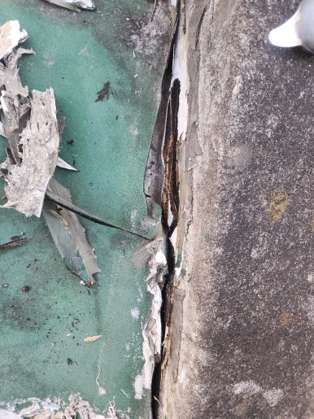
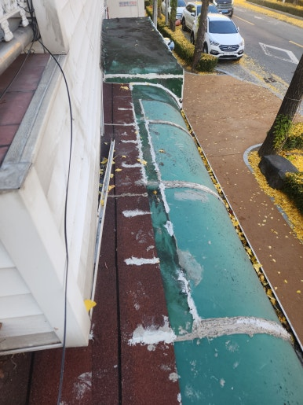
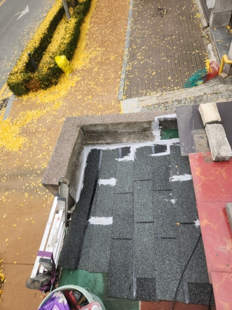
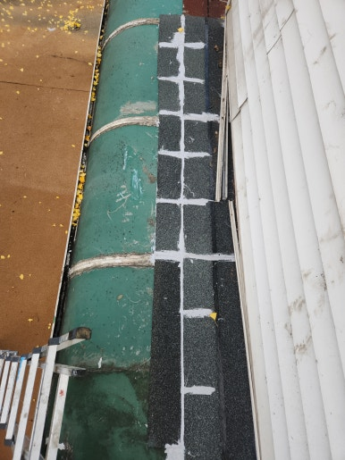

오랜 시간 비바람과 햇빛에 노출된 렉산지붕은 노후화로 인해 연결 부위와 고정 부위에 틈이 생기거나 기존 실리콘·방수 마감재가 갈라지면서 빗물 누수로 이어지기 쉽습니다.

렉산지붕 누수는 단순히 물이 떨어지는 부분만 막는다고 완벽하게 해결되지 않으며, 빗물이 유입되는 정확한 원인을 파악하고 지붕 연결 부위와 주변 마감 상태까지 함께 점검·보수해야 재발 가능성을 줄일 수 있습니다.

특히 처음에는 작은 틈새에서 시작된 누수라도 방치할 경우 지붕 아래 목재와 주변 구조물 손상, 천장·벽면의 물 얼룩 및 곰팡이 발생 등 내부 환경 악화와 보수 비용 증가로 이어질 수 있어 초기 대응이 중요합니다.

이번 현장은 울산 북구 소재 현장으로, 노후되어 누수 우려가 있던 렉산지붕의 이음새와 틈새 취약 부위를 꼼꼼하게 점검한 뒤 보강 및 방수 마감 작업까지 안전하게 완료해 드렸습니다.

---

## 노후 렉산지붕 누수 방수가 중요한 이유

- **빗물 유입 및 누수 차단**: 지붕 연결 부위와 고정 부위에 생긴 틈새를 정비해 우천 시 지붕 아래로 빗물이 스며들거나 떨어지는 현상 예방
- **목재 및 주변 구조물 보호**: 지속적인 습기 유입으로 인한 지붕 하부 목재 부식과 천장·벽면의 물 얼룩 및 곰팡이 발생 방지
- **방수 마감재 균열 확대 방지**: 오래되어 갈라진 기존 실리콘 및 방수 마감재를 정리하고 재보강하여 노후화 진행 억제
- **연결 부위 정밀 마감으로 재발 최소화**: 단순 부분 수리를 넘어 지붕 이음새와 주변 마감 라인까지 통합 점검·시공해 누수 재발 차단
- **유지보수 비용 절감**: 누수 피해 범위가 커져 전체 지붕을 교체하기 전, 적기에 필요한 부분만 방수 보수하여 관리 효율 극대화

---

## 1. 시공 전

현장 점검 결과, 울산 북구 현장의 렉산지붕은 오랜 세월 비바람을 맞으며 전반적인 노후화가 진행되어 있었고, 지붕 이음새와 틈새 부위를 통한 빗물 유입 및 누수가 우려되는 상태였습니다.

누수가 의심되는 취약 부위와 기존 마감 상태를 면밀히 확인한 후 본격적인 방수 보수 작업을 준비했습니다.

| :---: | :---: |
|  |  |

---

## 2. 시공 중

빗물이 유입되는 취약 부위를 정확히 보강하고, 지붕 이음새와 주변 마감까지 빈틈없이 정리하는 데 중점을 두고 작업을 진행했습니다.

1. **현장 상태 점검**: 기존 렉산지붕의 노후 상태 및 정확한 누수 취약 부위 확인
2. **기존 마감 정비**: 노후되어 갈라진 방수 마감재 및 주변 이물질 깔끔하게 정리
3. **누수 부위 보수**: 빗물이 유입되는 틈새 및 지붕 연결 부위 집중 보강
4. **방수 마감 작업**: 취약 부위 방수 처리 및 이음새 마감 라인 정밀 정리
5. **최종 점검**: 방수 시공 부위 및 지붕 전체 상태 확인으로 마감 완성도 최종 점검

---

## 3. 시공 후

노후되었던 렉산지붕의 누수 취약 부위 보강과 연결 부위 방수 마감 작업을 모두 마쳤습니다.

틈새와 이음새가 깔끔하게 방수 처리되어 고객님께서도 렉산지붕 누수 걱정을 덜게 되어 마음이 놓인다며 꼼꼼한 작업 결과에 매우 만족해하셨습니다.

| :---: | :---: |
|  |  |

---

## 이런 분들께 추천합니다!

- **추천 대상**: 비가 올 때 렉산지붕 아래로 물이 떨어지거나 연결 부위에서 누수가 발생하시는 분, 오래된 실리콘·방수 마감재가 갈라지고 이음새에 틈이 생기신 분, 전체 지붕 교체 전 필요한 부위의 꼼꼼한 부분 방수 보수를 원하시는 분
- **출장 가능 지역**: 제주 제외 전국
- **문의 안내**: 정직하고 투명한 현장 맞춤 진단과 합리적인 견적으로 꼭 필요한 작업만 꼼꼼하게 시공해 드립니다.

  
    Naver Blog
  

  <h3 style="margin: 0 0 10px 0; font-size: 20px; color: #1a1a1a;">
    현장 전체 시공 과정이 궁금하시다면?
  </h3>

  

    블로그에서 더 상세한 <strong style="color: #03C75A;">작업 단계별 사진과 세부 시공 팁</strong>을 확인해 보세요.
  

  <a href="https://blog.naver.com/homecare__119/224484447377"
     target="_blank"
     rel="noopener"
     style="display: inline-flex;
            align-items: center;
            justify-content: center;
            gap: 8px;
            background: #03C75A;
            color: #ffffff;
            text-decoration: none;
            padding: 14px 28px;
            border-radius: 50px;
            font-weight: 700;
            font-size: 15px;
            box-shadow: 0 4px 14px rgba(3, 199, 90, 0.35);
            transition: all 0.2s ease;">
    네이버 블로그에서 자세히 보기
    →
  </a>

<section style="background: #ffffff;
                border: 1px solid #eee;
                border-radius: 16px;
                padding: 32px 24px;
                margin-top: 40px;
                text-align: center;">

  <h2 style="margin-top: 0; margin-bottom: 16px; font-size: 22px; color: #222;">
    시공 및 견적 문의 안내
  </h2>

  

    <strong>노후 렉산지붕 누수 방수 · 지붕 틈새 및 이음새 보수 · 노후 방수 마감재 보강</strong> 
    <strong>제주 제외 전국</strong> 현장 맞춤 진단 후 꼼꼼하게 시공합니다. 
    전화, 문자, 카카오톡 중 편하신 방법으로 부담 없이 문의해 주세요!
  

  

  

    현장 사진을 미리 찍어서 보내주시면 더욱 정확하고 빠른 상담이 가능합니다. 😀
  

</section>
