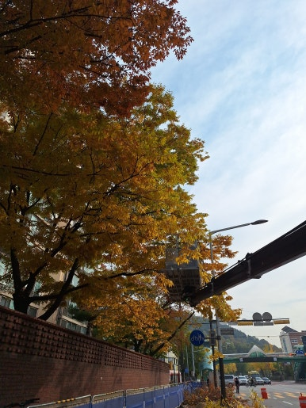
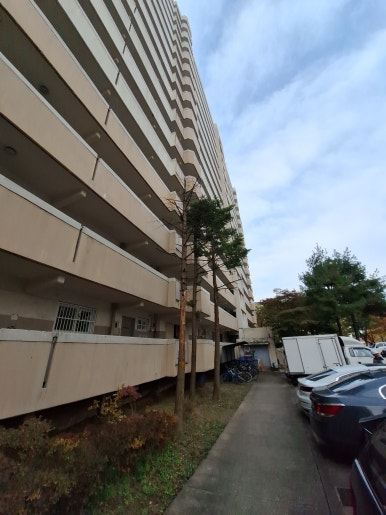
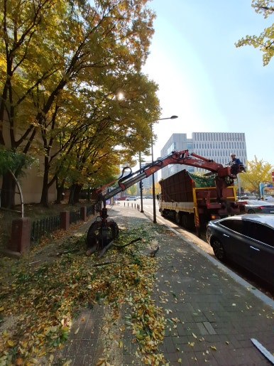
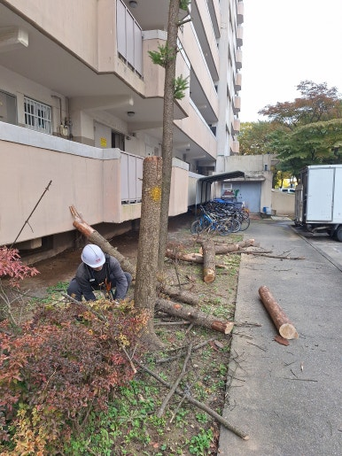

아파트 단지 내 조경수는 정기적인 전지와 관리가 이루어지지 않으면 나뭇가지가 무성해져 담장과 보행로를 가리고, 말라죽은 고사목이 방치될 경우 안전사고로 이어질 수 있습니다.

특히 담장 주변의 수목은 가지가 과도하게 자라면 입주민의 통행 불편은 물론 담장 및 주변 시설물과의 마찰, 해충 서식 환경 조성, 조경 미관 저하 등의 문제를 유발합니다.

이번 현장은 경북 김천시 소재 아파트 단지로, 통행과 미관을 방해하던 담장 주변의 무성한 나뭇가지를 깔끔하게 전지하고 쓰러질 위험이 있던 단지 내 고사목까지 안전하게 제거해 드렸습니다.

---

## 아파트 수목 전지 및 고사목 제거가 중요한 이유

- **보행로 및 통행 공간 확보**: 무성하게 자라 보행로와 차량 통행 공간을 침범하던 나뭇가지를 정비해 쾌적한 이동 동선 확보
- **담장 및 주변 시설물 보호**: 담장이나 건물 외벽, 인근 시설물에 닿아 손상을 유발할 수 있는 불필요한 가지 사전 정리
- **고사목 낙하 및 전도 사고 예방**: 말라죽어 약해진 고사목과 부러지기 쉬운 가지를 안전하게 제거해 강풍 시 안전사고 차단
- **해충 서식 예방 및 조경 미관 개선**: 얽히고 지저분해진 수목과 고사목을 정리해 벌레·해충 발생을 줄이고 깔끔한 단지 환경 조성
- **맞춤형 수형 관리**: 단순 절단을 넘어 나무 상태와 주변 환경을 고려한 균형 잡힌 전지 작업으로 건강한 조경 유지

---

## 1. 시공 전

현장 점검 결과, 경북 김천시 아파트 현장은 담장 주변 수목의 나뭇가지가 과도하게 성장해 주변 공간을 가리고 있었으며, 단지 내에는 말라죽은 고사목이 자리하고 있어 안전과 미관 모두 정비가 필요한 상태였습니다.

수목 상태와 주변 통행 환경, 작업 범위를 면밀히 확인한 후 본격적인 전지 및 벌목 작업을 준비했습니다.

| :---: | :---: |
|  |  |

---

## 2. 시공 중

주변 보행자와 시설물의 안전을 최우선으로 확보한 뒤, 불필요한 나뭇가지 정리와 고사목 제거 작업을 체계적으로 진행했습니다.

1. **현장 상태 점검**: 수목 생육 상태, 고사목 위치 및 전체 작업 범위 확인
2. **전지 작업 준비**: 작업 구역 주변 통행 공간 통제 및 안전 상태 점검
3. **담장 주변 전지 작업**: 담장과 보행로를 침범한 불필요한 나뭇가지 정리 및 수형 정돈
4. **고사목 제거 작업**: 쓰러질 위험이 있는 말라죽은 나무를 안전하게 절단 및 제거
5. **마무리 정리**: 작업 후 발생한 잔가지와 폐목을 수거하고 주변 현장 깔끔하게 청소

---

## 3. 시공 후

아파트 담장 주변의 무성했던 나뭇가지 전지와 단지 내 고사목 제거, 잔가지 및 폐목 수거까지 모든 작업을 마쳤습니다.

복잡하고 답답해 보이던 담장 주변과 조경 공간이 깔끔하게 정돈되어 고객님께서도 무성했던 가지와 고사목이 정리되니 단지 주변이 훨씬 쾌적해졌다며 작업 결과에 매우 만족해하셨습니다.

| :---: | :---: |
|  |  |

---

## 이런 분들께 추천합니다!

- **추천 대상**: 아파트·주택 담장 주변 나뭇가지가 무성하게 자라 정리가 필요하신 분, 보행로나 차량 통행을 방해하는 가지를 안전하게 전지하고 싶으신 분, 단지 내 말라죽어 전도 위험이 있는 고사목 제거와 폐목 수거까지 한 번에 해결하고 싶으신 분
- **출장 가능 지역**: 제주 제외 전국
- **문의 안내**: 정직하고 투명한 현장 맞춤 진단과 합리적인 견적으로 꼭 필요한 작업만 꼼꼼하게 시공해 드립니다.

  
    Naver Blog
  

  <h3 style="margin: 0 0 10px 0; font-size: 20px; color: #1a1a1a;">
    현장 전체 시공 과정이 궁금하시다면?
  </h3>

  

    블로그에서 더 상세한 <strong style="color: #03C75A;">작업 단계별 사진과 세부 시공 팁</strong>을 확인해 보세요.
  

  <a href="https://blog.naver.com/homecare__119/224486177864"
     target="_blank"
     rel="noopener"
     style="display: inline-flex;
            align-items: center;
            justify-content: center;
            gap: 8px;
            background: #03C75A;
            color: #ffffff;
            text-decoration: none;
            padding: 14px 28px;
            border-radius: 50px;
            font-weight: 700;
            font-size: 15px;
            box-shadow: 0 4px 14px rgba(3, 199, 90, 0.35);
            transition: all 0.2s ease;">
    네이버 블로그에서 자세히 보기
    →
  </a>

<section style="background: #ffffff;
                border: 1px solid #eee;
                border-radius: 16px;
                padding: 32px 24px;
                margin-top: 40px;
                text-align: center;">

  <h2 style="margin-top: 0; margin-bottom: 16px; font-size: 22px; color: #222;">
    시공 및 견적 문의 안내
  </h2>

  

    <strong>수목 전지 · 고사목 제거 및 벌목 · 잔가지 및 폐목 수거 정리</strong> 
    <strong>제주 제외 전국</strong> 현장 맞춤 진단 후 꼼꼼하게 시공합니다. 
    전화, 문자, 카카오톡 중 편하신 방법으로 부담 없이 문의해 주세요!
  

  

  

    현장 사진을 미리 찍어서 보내주시면 더욱 정확하고 빠른 상담이 가능합니다. 😀
  

</section>
