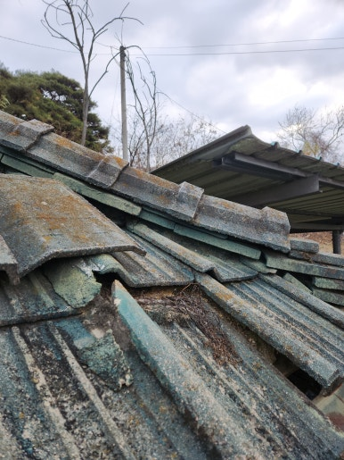
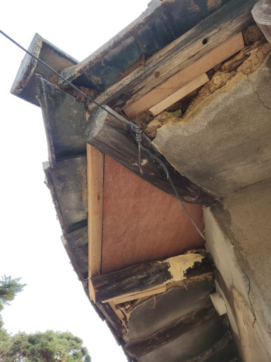
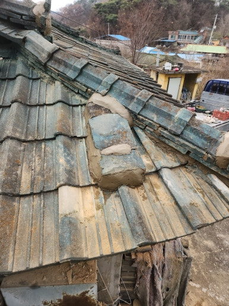
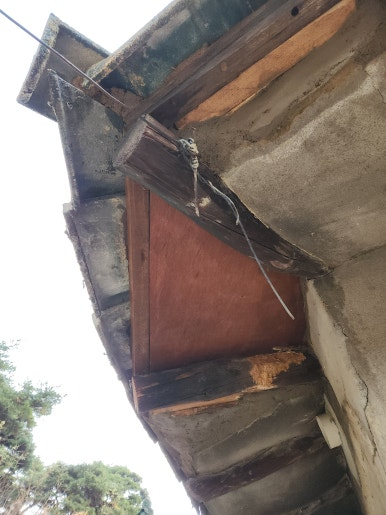

주택 기와지붕은 오랜 시간 비바람과 강한 햇빛에 노출되면서 기와 파손이나 밀림, 들뜸으로 인한 누수가 발생할 수 있습니다.

특히 기와지붕은 작은 틈 하나만으로도 빗물이 침투해 천장과 벽체 손상, 지붕 내부 목재 구조물 부식, 실내 곰팡이 및 단열 성능 저하로 이어질 수 있어 정확한 원인 파악과 초기 보수가 매우 중요합니다.

이번 현장은 경북 예천군 소재 주택으로, 노후된 기와 상태와 누수 우려 부위를 면밀히 점검한 뒤 손상 부위 보수 및 맞춤형 방수 작업을 진행해 안전하고 쾌적한 주거 환경을 조성해 드렸습니다.

---

## 노후 기와지붕 누수 보수가 중요한 이유

- **천장 및 벽체 손상 예방**: 비가 온 뒤 천장이나 벽면에 물 자국이 생기거나 내부로 빗물이 유입되는 피해 사전 차단
- **지붕 구조물 부식 방지**: 빗물 침투로 인한 지붕 내부 목재 구조물의 부식과 손상을 막아 건물 수명 연장
- **실내 습기 및 곰팡이 차단**: 지붕 내부 습기 유입을 막아 곰팡이 발생 및 주거 환경 악화 예방
- **단열 성능 유지**: 누수로 인한 단열재 손상과 주택 단열 성능 저하를 방지해 쾌적한 실내 환경 유지
- **수리 비용 절감**: 초기 손상 단계에서 기와 틈새와 연결 부위를 보강하여 누수 범위 확대에 따른 대규모 보수 비용 예방

---

## 1. 시공 전

현장 점검 결과, 경북 예천군 주택 현장은 기존 기와지붕의 노후화로 인해 기와 파손과 들뜸 현상이 확인되었으며, 기와 사이 틈새 및 취약 부위를 통한 누수 발생 우려가 큰 상태였습니다.

기존 기와 자재의 상태와 배열, 지붕 구조와 전체적인 손상 범위를 꼼꼼히 확인한 후 본격적인 보수 및 방수 작업을 준비했습니다.

| :---: | :---: |
|  |  |

---

## 2. 시공 중

기와 상태와 지붕 구조에 맞는 적절한 보수 공법을 적용하여 파손·들뜬 기와 정비부터 취약 부위 방수 처리까지 체계적으로 진행했습니다.

1. **현장 점검**: 노후 기와 상태 및 실제 누수 발생·우려 부위 정밀 확인
2. **표면 정리**: 지붕 위 이물질을 제거하고 작업 부위를 깔끔하게 정돈
3. **손상 부위 보수**: 파손 및 들뜬 기와 정비와 벌어진 틈새 부분 보강
4. **방수 작업**: 용마루 및 지붕 연결 부위 등 누수 취약 부위 중심 방수 처리
5. **마무리 점검**: 전체 보수 상태 최종 확인 및 작업 주변 현장 정리

---

## 3. 시공 후

노후 기와지붕의 손상 기와 정비와 취약 구간 방수 보강, 주변 정리까지 모든 작업을 깔끔하게 마쳤습니다.

누수 위험이 있던 기와 틈새와 노후 부위가 탄탄하게 보수되어 비가 와도 누수 걱정 없이 안전하게 지낼 수 있도록 마무리했습니다.

| :---: | :---: |
|  |  |

---

## 이런 분들께 추천합니다!

- **추천 대상**: 비가 올 때 천장에서 물이 떨어지거나 물 자국이 생기시는 분, 오래된 기와가 깨지거나 갈라져 보수가 필요하신 분, 기와 밀림·들뜸 및 용마루·지붕 가장자리 누수로 방수 보강을 원하시는 분
- **출장 가능 지역**: 제주 제외 전국
- **문의 안내**: 정직하고 투명한 현장 맞춤 진단과 합리적인 견적으로 꼭 필요한 작업만 꼼꼼하게 시공해 드립니다.

  
    Naver Blog
  

  <h3 style="margin: 0 0 10px 0; font-size: 20px; color: #1a1a1a;">
    현장 전체 시공 과정이 궁금하시다면?
  </h3>

  

    블로그에서 더 상세한 <strong style="color: #03C75A;">작업 단계별 사진과 세부 시공 팁</strong>을 확인해 보세요.
  

  <a href="https://blog.naver.com/homecare__119/224489062214"
     target="_blank"
     rel="noopener"
     style="display: inline-flex;
            align-items: center;
            justify-content: center;
            gap: 8px;
            background: #03C75A;
            color: #ffffff;
            text-decoration: none;
            padding: 14px 28px;
            border-radius: 50px;
            font-weight: 700;
            font-size: 15px;
            box-shadow: 0 4px 14px rgba(3, 199, 90, 0.35);
            transition: all 0.2s ease;">
    네이버 블로그에서 자세히 보기
    →
  </a>

<section style="background: #ffffff;
                border: 1px solid #eee;
                border-radius: 16px;
                padding: 32px 24px;
                margin-top: 40px;
                text-align: center;">

  <h2 style="margin-top: 0; margin-bottom: 16px; font-size: 22px; color: #222;">
    시공 및 견적 문의 안내
  </h2>

  

    <strong>노후 기와지붕 누수 점검 · 손상 부위 보수 · 기와 틈새 및 용마루 방수 보강</strong> 
    <strong>제주 제외 전국</strong> 현장 맞춤 진단 후 꼼꼼하게 시공합니다. 
    전화, 문자, 카카오톡 중 편하신 방법으로 부담 없이 문의해 주세요!
  

  

  

    현장 사진을 미리 찍어서 보내주시면 더욱 정확하고 빠른 상담이 가능합니다. 😀
  

</section>
