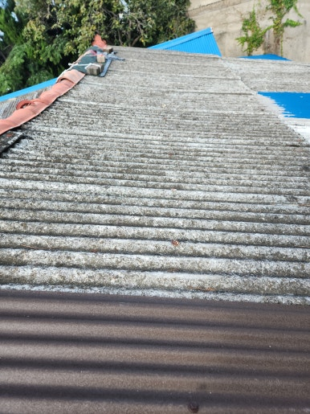
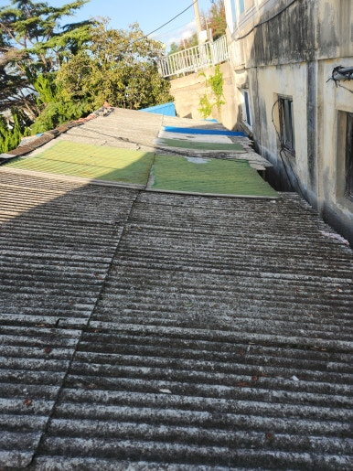
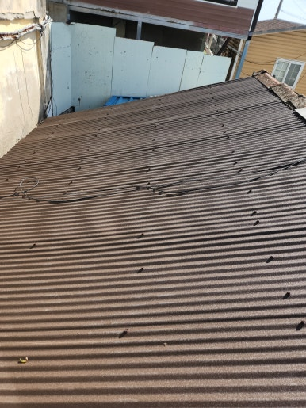
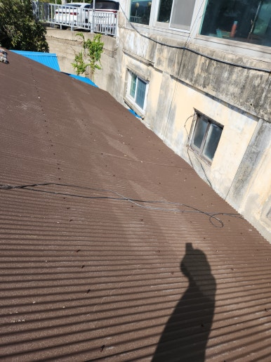

노후된 슬레이트 지붕은 오랜 시간 비바람과 외부 환경에 노출되면서 자재가 약해지고 표면 균열이나 파손이 발생할 수 있습니다.

이러한 지붕 노후화를 방치할 경우 빗물 침투로 인한 천장 누수는 물론, 지붕 내부 목재 구조물 부식, 실내 습기와 곰팡이 발생, 나아가 손상 범위 확대에 따른 보수 비용 증가로 이어질 수 있어 정확한 점검과 안전한 보강 시공이 매우 중요합니다.

이번 현장은 경북 김천시 소재 주택으로, 기존 슬레이트 지붕의 상태와 하부 구조를 면밀히 점검한 뒤 새로운 강판을 덧씌우는 강판 덧방 시공을 진행해 지붕 외관 개선과 확실한 누수 차단을 동시에 해결해 드렸습니다.

---

## 노후 슬레이트 지붕 강판 덧방 시공이 필요한 이유

- **천장 누수 및 빗물 유입 차단**: 오래된 슬레이트 표면의 균열과 파손 부위를 덮어 비가 올 때 발생하는 천장 누수를 원천 방지
- **지붕 내부 목재 부식 예방**: 지붕 내부로 습기와 빗물이 스며드는 것을 차단해 목재 구조물의 부식과 손상 예방
- **실내 습기 및 곰팡이 방지**: 지붕 방수 성능을 개선하여 결로·습기로 인한 실내 곰팡이 발생 및 주거 환경 저하 차단
- **지붕 외관 깔끔하게 개선**: 노후되고 변색된 기존 슬레이트 지붕 위에 새 강판을 시공하여 주택 전체의 외관 개선
- **보수 비용 증가 예방**: 지붕 손상이 더 넓은 범위로 번지기 전에 선제적으로 보강하여 추후 대규모 수리 비용 절감

---

## 1. 시공 전

현장 점검 결과, 경북 김천시 주택 현장은 기존 슬레이트 지붕의 노후화가 진행되어 지붕 표면 손상 및 빗물 누수 우려가 큰 상태였습니다.

기존 슬레이트 자재의 상태와 지붕 구조, 지지 구조의 보강 필요 여부까지 꼼꼼하게 확인한 후 본격적인 강판 덧방 시공을 준비했습니다.

| :---: | :---: |
|  |  |

---

## 2. 시공 중

단순히 지붕 위에 강판을 덮는 것이 아니라, 기존 지붕 구조와 연결 부위까지 고려해 빗물이 유입되지 않도록 체계적으로 시공을 진행했습니다.

1. **현장 점검**: 기존 슬레이트 상태 및 지붕 전반적인 구조 정밀 확인
2. **시공 준비**: 정확한 작업 범위 확인 및 현장 안전 조치 실시
3. **하부 구조 점검**: 지붕 지지 구조 상태 및 사전 보강 필요 부위 확인
4. **강판 덧방 시공**: 현장 규격과 구조에 맞는 강판 설치 및 견고한 고정 작업
5. **마무리 점검**: 강판 고정 상태와 연결 부위·지붕 가장자리 마감 최종 확인

---

## 3. 시공 후

기존 슬레이트 지붕 위 강판 덧방 시공과 연결 부위·가장자리 마감까지 모든 작업을 깔끔하게 마쳤습니다.

견고한 강판 고정과 빈틈없는 마감 처리로 방수 성능은 물론 지붕 외관까지 한층 깔끔하고 탄탄하게 개선되었습니다.

| :---: | :---: |
|  |  |

---

## 이런 분들께 추천합니다!

- **추천 대상**: 오래된 슬레이트 지붕의 노후화·균열로 누수가 걱정되시는 분, 기존 지붕의 방수 성능을 확실하게 개선하고 싶으신 분, 낡은 주택 지붕의 외관을 깔끔하게 바꾸고 유지 보수를 계획하시는 분
- **출장 가능 지역**: 제주 제외 전국
- **문의 안내**: 정직하고 투명한 현장 맞춤 진단과 합리적인 견적으로 꼭 필요한 작업만 꼼꼼하게 시공해 드립니다.

  
    Naver Blog
  

  <h3 style="margin: 0 0 10px 0; font-size: 20px; color: #1a1a1a;">
    현장 전체 시공 과정이 궁금하시다면?
  </h3>

  

    블로그에서 더 상세한 <strong style="color: #03C75A;">작업 단계별 사진과 세부 시공 팁</strong>을 확인해 보세요.
  

  <a href="https://blog.naver.com/homecare__119/224490129334"
     target="_blank"
     rel="noopener"
     style="display: inline-flex;
            align-items: center;
            justify-content: center;
            gap: 8px;
            background: #03C75A;
            color: #ffffff;
            text-decoration: none;
            padding: 14px 28px;
            border-radius: 50px;
            font-weight: 700;
            font-size: 15px;
            box-shadow: 0 4px 14px rgba(3, 199, 90, 0.35);
            transition: all 0.2s ease;">
    네이버 블로그에서 자세히 보기
    →
  </a>

<section style="background: #ffffff;
                border: 1px solid #eee;
                border-radius: 16px;
                padding: 32px 24px;
                margin-top: 40px;
                text-align: center;">

  <h2 style="margin-top: 0; margin-bottom: 16px; font-size: 22px; color: #222;">
    시공 및 견적 문의 안내
  </h2>

  

    <strong>노후 슬레이트 지붕 상태 점검 · 강판 덧방 시공 · 지붕 연결 부위 및 가장자리 마감</strong> 
    <strong>제주 제외 전국</strong> 현장 맞춤 진단 후 꼼꼼하게 시공합니다. 
    전화, 문자, 카카오톡 중 편하신 방법으로 부담 없이 문의해 주세요!
  

  

  

    현장 사진을 미리 찍어서 보내주시면 더욱 정확하고 빠른 상담이 가능합니다. 😀
  

</section>
