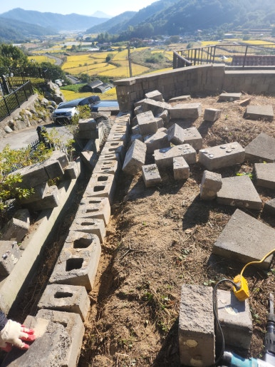
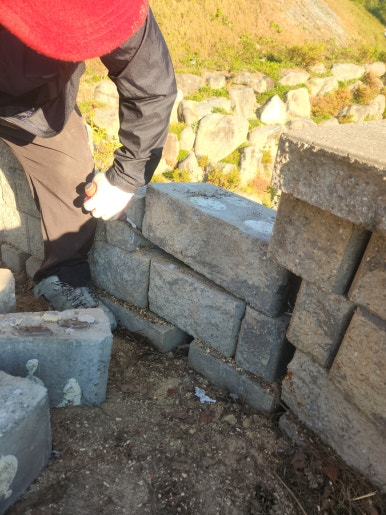
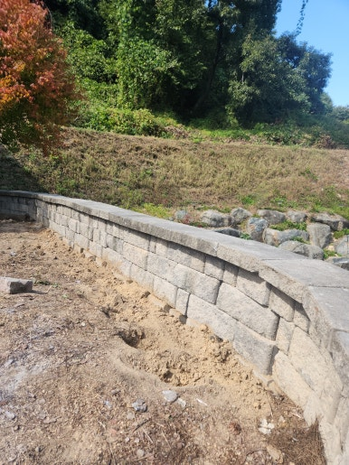
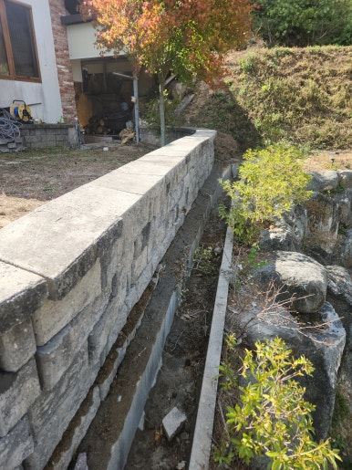

전원주택의 담장은 외부와 내부 공간을 구분해 주고 사생활과 주변 경관을 보호하는 중요한 시설물입니다.

특히 담장이 기울어지거나 벽체에 균열·파손이 발생한 상태를 방치할 경우, 벽체 일부 탈락 및 낙하 위험, 빗물 유입에 따른 추가 손상, 나아가 보수 범위 확대에 따른 비용 증가로 이어질 수 있어 정확한 점검과 안전한 보수 시공이 매우 중요합니다.

이번 현장은 경북 칠곡군 소재 전원주택으로, 기존 경계 담장의 손상 상태와 기초·주변 구조를 면밀히 점검한 뒤 파손 부위 보강 및 보수 작업을 진행해 안전성과 깔끔한 외관을 동시에 회복해 드렸습니다.

---

## 전원주택 경계 담장 수리가 필요한 이유

- **균열 및 파손 범위 확대 방지**: 오래된 담장이나 외부 충격으로 훼손된 벽체 균열이 더 크게 번지는 것을 원천 차단
- **벽체 탈락 및 안전사고 예방**: 담장 일부가 떨어지거나 기울어지면서 발생할 수 있는 낙하 위험 및 안전 문제 해소
- **빗물 유입에 의한 추가 손상 차단**: 손상된 틈새로 빗물이 스며들어 내부 구조가 약해지는 현상 예방
- **주변 경관 및 외관 깔끔하게 개선**: 노후되고 파손된 담장을 주변 환경과 자연스럽게 어우러지도록 깔끔하게 복원
- **보수 비용 증가 예방**: 작은 손상 단계에서 선제적으로 보강하여 추후 대규모 수리 비용 절감

---

## 1. 시공 전

현장 점검 결과, 경북 칠곡군 전원주택 현장은 기존 경계 담장의 노후화와 함께 벽체 일부 파손이 진행되어 외관 개선과 안전성 확보가 필요한 상태였습니다.

손상 부위뿐만 아니라 주변 구조와 기초 상태까지 꼼꼼하게 확인한 후 본격적인 담장 보수 작업을 준비했습니다.

| :---: | :---: |
|  |  |

---

## 2. 시공 중

단순히 겉면만 메우는 것이 아니라, 기존 담장의 손상 원인과 주변 구조물과의 연결까지 고려해 튼튼하게 시공을 진행했습니다.

1. **현장 점검**: 기존 담장 손상 및 균열 상태, 기초 구조 정밀 확인
2. **작업 준비**: 보수 구간 정리 및 현장 주변 안전 조치 실시
3. **손상 부위 정리**: 파손된 부분 제거 및 깔끔한 보수 면 정리
4. **담장 보수 작업**: 손상 부위 구조 보강 및 현장 맞춤 보수 시공
5. **마무리 점검**: 보수 상태 최종 확인 및 현장 주변 정리

---

## 3. 시공 후

파손된 경계 담장의 보강 및 보수 작업과 주변 환경과 자연스럽게 어우러지는 마감 처리까지 모든 작업을 깔끔하게 마쳤습니다.

견고한 보수 시공으로 담장의 안전성은 물론 전원주택 주변 경관까지 한층 깔끔하고 탄탄하게 개선되었습니다.

| :---: | :---: |
|  |  |

---

## 이런 분들께 추천합니다!

- **추천 대상**: 전원주택 경계 담장의 노후화·균열로 안전이 걱정되시는 분, 외부 충격으로 담장 벽체 일부가 파손되신 분, 낡은 담장 외관을 주변 환경에 맞게 깔끔하게 정비하고 싶으신 분
- **출장 가능 지역**: 제주 제외 전국
- **문의 안내**: 정직하고 투명한 현장 맞춤 진단과 합리적인 견적으로 꼭 필요한 작업만 꼼꼼하게 시공해 드립니다.

  
    Naver Blog
  

  <h3 style="margin: 0 0 10px 0; font-size: 20px; color: #1a1a1a;">
    현장 전체 시공 과정이 궁금하시다면?
  </h3>

  

    블로그에서 더 상세한 <strong style="color: #03C75A;">작업 단계별 사진과 세부 시공 팁</strong>을 확인해 보세요.
  

  <a href="https://blog.naver.com/homecare__119/224492076571"
     target="_blank"
     rel="noopener"
     style="display: inline-flex;
            align-items: center;
            justify-content: center;
            gap: 8px;
            background: #03C75A;
            color: #ffffff;
            text-decoration: none;
            padding: 14px 28px;
            border-radius: 50px;
            font-weight: 700;
            font-size: 15px;
            box-shadow: 0 4px 14px rgba(3, 199, 90, 0.35);
            transition: all 0.2s ease;">
    네이버 블로그에서 자세히 보기
    →
  </a>

<section style="background: #ffffff;
                border: 1px solid #eee;
                border-radius: 16px;
                padding: 32px 24px;
                margin-top: 40px;
                text-align: center;">

  <h2 style="margin-top: 0; margin-bottom: 16px; font-size: 22px; color: #222;">
    시공 및 견적 문의 안내
  </h2>

  

    <strong>전원주택 경계 담장 상태 점검 · 노후 담장 균열 및 파손 부위 보수 · 담장 손상 부위 보강</strong> 
    <strong>제주 제외 전국</strong> 현장 맞춤 진단 후 꼼꼼하게 시공합니다. 
    전화, 문자, 카카오톡 중 편하신 방법으로 부담 없이 문의해 주세요!
  

  

  

    현장 사진을 미리 찍어서 보내주시면 더욱 정확하고 빠른 상담이 가능합니다. 😀
  

</section>
