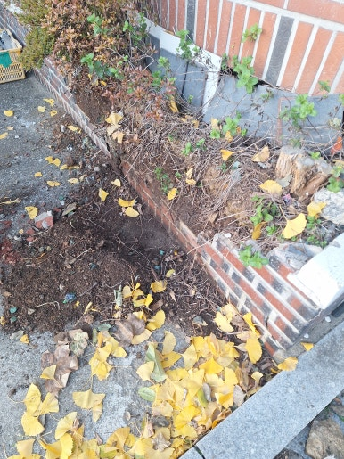
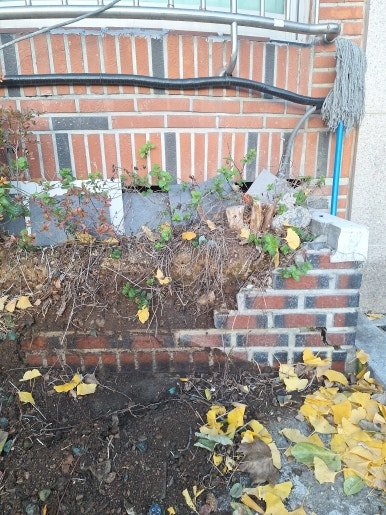
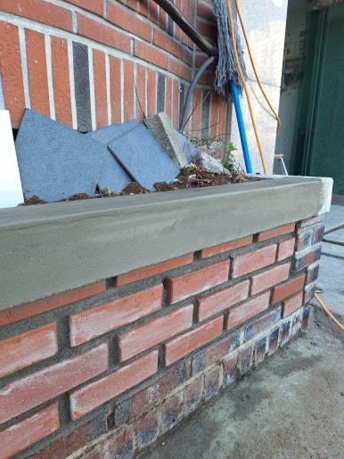
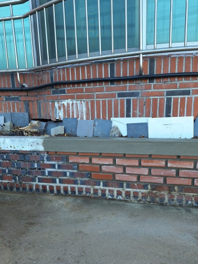

빌라 외부 적벽돌 화단은 공간을 깔끔하게 정리해 주고 조경 구역을 구분해 주는 중요한 시설물입니다.

특히 화단 테두리 벽돌이 흔들리거나 줄눈이 탈락한 상태를 방치할 경우, 벽돌 틈새 벌어짐 및 이탈, 빗물·습기 유입으로 인한 접합부 약화, 나아가 보수 범위 확대에 따른 비용 증가로 이어질 수 있어 초기 점검과 튼튼한 보수 시공이 매우 중요합니다.

이번 현장은 경북 안동시 소재 빌라로, 기존 적벽돌 화단의 노후화와 손상 상태를 면밀히 점검한 뒤 벽돌 재정렬 및 고정, 줄눈 마감 작업을 진행해 안전성과 깔끔한 외관을 동시에 회복해 드렸습니다.

---

## 적벽돌 화단 테두리 보수가 필요한 이유

- **벽돌 틈새 벌어짐 및 이탈 방지**: 흔들리거나 들뜬 적벽돌을 재정렬하고 고정해 추가 탈락 차단
- **줄눈 및 접합부 약화 예방**: 벽돌 사이 노후 줄눈이 떨어져 틈이 생기는 현상을 보강해 구조적 안정성 확보
- **빗물과 습기로 인한 추가 손상 차단**: 벌어진 틈새로 빗물과 습기가 스며들어 마감부가 손상되는 문제 예방
- **빌라 외부 경관 및 외관 깔끔하게 개선**: 울퉁불퉁하고 지저분해진 화단 테두리를 주변 환경과 어우러지도록 깔끔하게 복원
- **보수 범위 확대 및 비용 증가 예방**: 전체 철거 없이 손상 부위를 선제적으로 부분 보수하여 대규모 수리 비용 절감

---

## 1. 시공 전

현장 점검 결과, 경북 안동시 빌라 현장은 기존 적벽돌 화단 테두리의 노후화와 함께 벽돌 틈새 벌어짐 및 마감 상태 불량이 진행되어 외관 정리와 구조 보강이 필요한 상태였습니다.

파손된 벽돌뿐만 아니라 주변 벽돌의 고정 상태와 바탕면까지 꼼꼼하게 확인한 후 본격적인 화단 테두리 보수 작업을 준비했습니다.

| :---: | :---: |
|  |  |

---

## 2. 시공 중

단순히 깨진 벽돌만 교체하는 것이 아니라, 기존 적벽돌의 상태와 주변 구조와의 연결까지 고려해 견고하게 시공을 진행했습니다.

1. **현장 상태 점검**: 기존 적벽돌의 노후 및 파손·흔들림 부위 정밀 확인
2. **손상 부위 정리**: 들뜬 벽돌 및 탈락한 노후 줄눈 제거
3. **바탕면 정비**: 보수 부위의 이물질 제거 및 깔끔한 바탕면 정리
4. **적벽돌 보수 작업**: 벽돌 재정렬 및 모르타르를 활용한 견고한 고정 시공
5. **마감 및 최종 점검**: 줄눈 라인 정리 및 주변 청소 후 최종 상태 확인

---

## 3. 시공 후

손상된 적벽돌 화단 테두리의 재정렬·고정 작업과 깔끔한 줄눈 마감 처리까지 모든 작업을 정교하게 마쳤습니다.

견고한 보수 시공으로 화단의 구조적 안정성은 물론 빌라 외부 공간 전체가 한층 정돈되고 깔끔하게 개선되었습니다.

| :---: | :---: |
|  |  |

---

## 이런 분들께 추천합니다!

- **추천 대상**: 화단 테두리 벽돌이 깨지거나 떨어져 보수가 필요하신 분, 벽돌 사이 줄눈이 탈락하고 틈이 생겨 외관이 지저분해진 분, 전체 철거 없이 기존 적벽돌 화단을 깔끔하게 부분 보수하고 싶으신 분
- **출장 가능 지역**: 제주 제외 전국
- **문의 안내**: 정직하고 투명한 현장 맞춤 진단과 합리적인 견적으로 꼭 필요한 작업만 꼼꼼하게 시공해 드립니다.

  
    Naver Blog
  

  <h3 style="margin: 0 0 10px 0; font-size: 20px; color: #1a1a1a;">
    현장 전체 시공 과정이 궁금하시다면?
  </h3>

  

    블로그에서 더 상세한 <strong style="color: #03C75A;">작업 단계별 사진과 세부 시공 팁</strong>을 확인해 보세요.
  

  <a href="https://blog.naver.com/homecare__119/224492877628"
     target="_blank"
     rel="noopener"
     style="display: inline-flex;
            align-items: center;
            justify-content: center;
            gap: 8px;
            background: #03C75A;
            color: #ffffff;
            text-decoration: none;
            padding: 14px 28px;
            border-radius: 50px;
            font-weight: 700;
            font-size: 15px;
            box-shadow: 0 4px 14px rgba(3, 199, 90, 0.35);
            transition: all 0.2s ease;">
    네이버 블로그에서 자세히 보기
    →
  </a>

<section style="background: #ffffff;
                border: 1px solid #eee;
                border-radius: 16px;
                padding: 32px 24px;
                margin-top: 40px;
                text-align: center;">

  <h2 style="margin-top: 0; margin-bottom: 16px; font-size: 22px; color: #222;">
    시공 및 견적 문의 안내
  </h2>

  

    <strong>적벽돌 화단 테두리 파손 및 균열 보수 · 흔들리는 벽돌 재정렬 및 고정 · 노후 줄눈 및 마감 정비</strong> 
    <strong>제주 제외 전국</strong> 현장 맞춤 진단 후 꼼꼼하게 시공합니다. 
    전화, 문자, 카카오톡 중 편하신 방법으로 부담 없이 문의해 주세요!
  

  

  

    현장 사진을 미리 찍어서 보내주시면 더욱 정확하고 빠른 상담이 가능합니다. 😀
  

</section>
