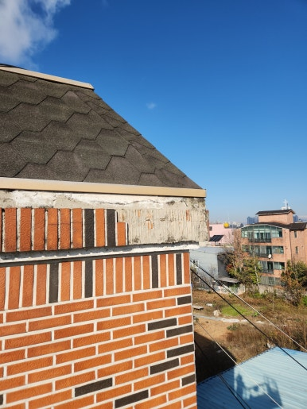
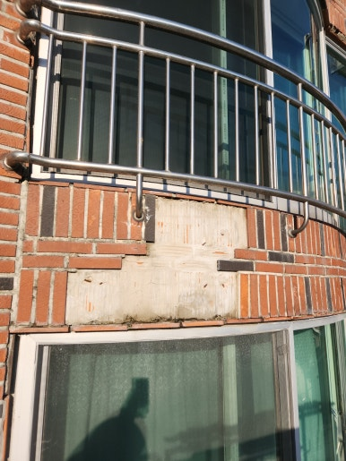
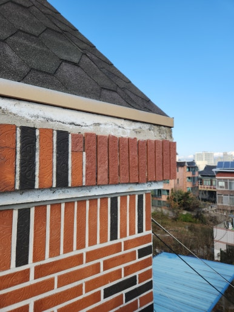
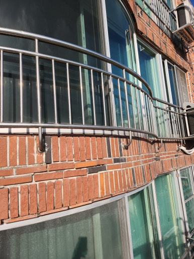

빌라 외부 외장 타일은 건물의 외관을 깔끔하게 보호하고 빗물과 습기로부터 외벽 구조를 지켜주는 중요한 마감재입니다.

특히 지붕 아래나 외벽 타일이 들뜨고 탈락한 상태를 방치할 경우, 주변 타일의 연쇄 탈락 및 낙하로 인한 보행자 안전사고, 외벽 내부 빗물 유입, 나아가 보수 범위 확대에 따른 비용 증가로 이어질 수 있어 초기 점검과 튼튼한 재시공이 매우 중요합니다.

이번 현장은 경북 김천시 소재 빌라로, 노후화와 접착력 저하로 탈락한 지붕 아래쪽 외벽 타일 상태를 면밀히 점검한 뒤 손상 부위 정리 및 타일 재시공, 줄눈 마감 작업을 진행해 안전성과 깔끔한 외관을 동시에 회복해 드렸습니다.

---

## 외벽 타일 재시공이 필요한 이유

- **주변 타일 추가 탈락 및 안전사고 예방**: 들뜨고 흔들리는 외벽 타일을 견고하게 재시공해 낙하로 인한 보행자 및 주변 시설물 피해 차단
- **외벽 내부 빗물 유입 차단**: 타일 및 줄눈 탈락으로 생긴 틈새를 보강해 외벽 내부로 빗물과 습기가 스며드는 문제 예방
- **접착 및 고정 상태 구조적 보강**: 노후화된 기존 접착층을 제거하고 바탕면을 정비한 뒤 적합한 자재로 시공해 내구성 확보
- **빌라 외부 경관 및 외관 깔끔하게 개선**: 타일이 떨어져 지저분해진 지붕 아래 외벽을 기존 주변 타일과 자연스럽게 어우러지도록 복원
- **보수 범위 확대 및 비용 증가 예방**: 전체 외벽 철거 없이 탈락·손상 부위를 선제적으로 부분 보수하여 대규모 수리 비용 절감

---

## 1. 시공 전

현장 점검 결과, 경북 김천시 빌라 현장은 지붕 아래쪽 외벽 타일이 노후화와 접착력 저하로 탈락해 있었으며, 주변 타일 및 외벽 마감 상태도 불량해 안전 조치와 부분 재시공이 필요한 상태였습니다.

탈락한 부위뿐만 아니라 주변 타일의 들뜸 여부와 기존 바탕면 상태까지 꼼꼼하게 확인한 후 본격적인 외벽 타일 보수 작업을 준비했습니다.

| :---: | :---: |
|  |  |

---

## 2. 시공 중

단순히 떨어진 자리에 새 타일만 붙이는 것이 아니라, 기존 바탕면의 접착력과 주변 외벽과의 연결까지 고려해 견고하게 시공을 진행했습니다.

1. **현장 상태 점검**: 탈락 부위 및 주변 외벽 타일의 들뜸·흔들림 상태 정밀 확인
2. **손상 부위 정리**: 떨어진 타일 잔여물과 노후된 기존 접착층 제거
3. **바탕면 정비**: 보수 부위의 이물질 제거 및 깔끔한 재시공 바탕면 정리
4. **외장 타일 재시공**: 기존 외벽과 자연스럽게 어울리도록 타일 재배치 및 견고한 고정 시공
5. **줄눈 및 마감 작업**: 접합부 줄눈 라인 정리 및 주변 청소 후 최종 상태 점검

---

## 3. 시공 후

탈락했던 지붕 아래 외벽 타일의 재시공 작업과 깔끔한 줄눈 마감 처리까지 모든 작업을 정교하게 마쳤습니다.

견고한 보수 시공으로 외벽의 안전성 확보는 물론 기존 외벽과 자연스럽게 어우러져 건물 전체 외관이 한층 정돈되고 깔끔하게 개선되었습니다.

| :---: | :---: |
|  |  |

---

## 이런 분들께 추천합니다!

- **추천 대상**: 빌라 외벽이나 지붕 아래쪽 타일이 떨어져 재시공이 필요하신 분, 외장 타일이 들뜨고 흔들리거나 줄눈이 탈락해 안전과 외관이 걱정되시는 분, 전체 외벽 철거 없이 손상 부위만 깔끔하게 부분 보수하고 싶으신 분
- **출장 가능 지역**: 제주 제외 전국
- **문의 안내**: 정직하고 투명한 현장 맞춤 진단과 합리적인 견적으로 꼭 필요한 작업만 꼼꼼하게 시공해 드립니다.

  
    Naver Blog
  

  <h3 style="margin: 0 0 10px 0; font-size: 20px; color: #1a1a1a;">
    현장 전체 시공 과정이 궁금하시다면?
  </h3>

  

    블로그에서 더 상세한 <strong style="color: #03C75A;">작업 단계별 사진과 세부 시공 팁</strong>을 확인해 보세요.
  

  <a href="https://blog.naver.com/homecare__119/224495137348"
     target="_blank"
     rel="noopener"
     style="display: inline-flex;
            align-items: center;
            justify-content: center;
            gap: 8px;
            background: #03C75A;
            color: #ffffff;
            text-decoration: none;
            padding: 14px 28px;
            border-radius: 50px;
            font-weight: 700;
            font-size: 15px;
            box-shadow: 0 4px 14px rgba(3, 199, 90, 0.35);
            transition: all 0.2s ease;">
    네이버 블로그에서 자세히 보기
    →
  </a>

<section style="background: #ffffff;
                border: 1px solid #eee;
                border-radius: 16px;
                padding: 32px 24px;
                margin-top: 40px;
                text-align: center;">

  <h2 style="margin-top: 0; margin-bottom: 16px; font-size: 22px; color: #222;">
    시공 및 견적 문의 안내
  </h2>

  

    <strong>빌라 외벽 탈락 타일 재시공 및 보수 · 들뜨고 흔들리는 외장 타일 고정 · 외벽 줄눈 및 마감 정비</strong> 
    <strong>제주 제외 전국</strong> 현장 맞춤 진단 후 꼼꼼하게 시공합니다. 
    전화, 문자, 카카오톡 중 편하신 방법으로 부담 없이 문의해 주세요!
  

  

  

    현장 사진을 미리 찍어서 보내주시면 더욱 정확하고 빠른 상담이 가능합니다. 😀
  

</section>
