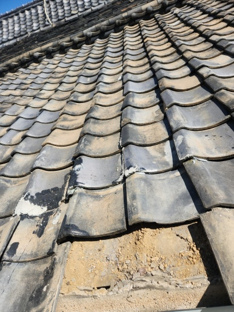
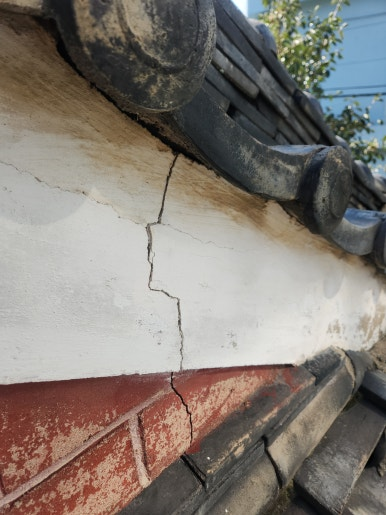
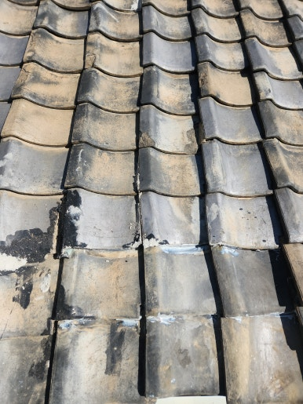
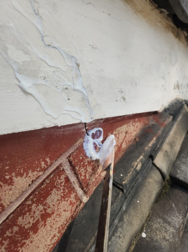

주택의 기와지붕은 빗물과 외부 환경으로부터 건물 내부를 보호하는 핵심 구조물입니다.

특히 노후화로 인해 기와가 깨지거나 밀려 틈새가 벌어질 경우, 천장 및 실내 벽면 누수, 목재 지붕 구조물 부식, 곰팡이 발생 및 단열 저하, 나아가 손상 범위 확대에 따른 보수 비용 증가로 이어질 수 있어 초기 점검과 정확한 방수 보수가 매우 중요합니다.

이번 현장은 울산 북구 소재 주택으로, 노후화와 기와 파손·밀림으로 인해 누수가 발생한 지붕 상태를 면밀히 점검한 뒤 손상 부위 방수 보강 및 기와 재정비 작업을 진행해 빗물 유입을 완벽히 차단해 드렸습니다.

---

## 노후 기와지붕 누수 보수가 필요한 이유

- **천장 및 실내 벽면 누수 차단**: 기와 파손이나 틈새 벌어짐으로 유입되는 빗물을 막아 실내 침수 및 마감재 손상 예방
- **목재 지붕 구조물 부식 및 곰팡이 예방**: 습기 유입으로 인한 지붕 내부 목재의 부식과 실내 곰팡이 발생·환경 악화 차단
- **지붕 방수 기능 및 단열 성능 회복**: 저하된 지붕 바탕면의 방수 상태를 보강해 건물의 내구성과 단열 효율 유지
- **기와 배열 및 고정 상태 재정비**: 깨지거나 위치가 어긋난 기와를 바르게 정렬하고 보수해 추가적인 기와 이탈 방지
- **보수 범위 확대 및 비용 증가 예방**: 전체 지붕 교체 없이 손상 및 누수 부위만 선제적으로 부분 보수하여 대규모 수리 비용 절감

---

## 1. 시공 전

현장 점검 결과, 울산 북구 주택 현장은 오래된 기와지붕의 노후화로 인해 기와가 깨지고 위치가 밀려 틈새가 벌어져 있었으며, 이로 인해 지붕 내부로 빗물이 유입되어 누수가 발생하는 상태였습니다.

눈에 보이는 기와 파손 부위뿐만 아니라 기와 아래쪽 바탕면과 전반적인 방수 상태까지 꼼꼼하게 확인한 후 본격적인 지붕 누수 보수 작업을 준비했습니다.

| :---: | :---: |
|  |  |

---

## 2. 시공 중

단순히 겉으로 드러난 깨진 기와만 덮는 것이 아니라, 기와 아래 바탕면과 방수층까지 함께 점검하여 누수 원인을 근본적으로 해결하는 방향으로 시공을 진행했습니다.

1. **현장 상태 점검**: 기와 파손 위치 및 실제 누수 발생 지점 정밀 확인
2. **손상 기와 정리**: 깨지거나 제 위치에서 밀린 기존 기와 해체 및 정리
3. **지붕 바탕면 점검**: 기와 아래쪽 바탕면 손상 여부 및 기존 방수 상태 확인
4. **누수 부위 보수**: 빗물 유입 경로 정비 및 누수 취약 부위 방수 보강 작업
5. **기와 재정비 및 마감**: 기와 배열 및 위치 조정 후 최종 누수 차단 상태 점검

---

## 3. 시공 후

파손되고 밀려 있던 기와 정비와 누수 부위 방수 보강, 깔끔한 지붕 마감 처리까지 모든 작업을 정교하게 마쳤습니다.

견고한 보수 시공으로 비가 와도 천장이나 벽면으로 물이 스며들지 않도록 안전성을 확보했으며, 어긋나 있던 지붕 라인도 반듯하고 깔끔하게 정리되었습니다.

| :---: | :---: |
|  |  |

---

## 이런 분들께 추천합니다!

- **추천 대상**: 비가 내릴 때마다 천장이나 벽면에 물이 스며들어 고민이신 분, 오래된 주택의 기와가 깨지거나 밀려 틈새로 빗물이 유입되는 분, 전체 지붕 교체 없이 누수 부위만 깔끔하게 부분 보수하고 싶으신 분
- **출장 가능 지역**: 제주 제외 전국
- **문의 안내**: 정직하고 투명한 현장 맞춤 진단과 합리적인 견적으로 꼭 필요한 작업만 꼼꼼하게 시공해 드립니다.

  
    Naver Blog
  

  <h3 style="margin: 0 0 10px 0; font-size: 20px; color: #1a1a1a;">
    현장 전체 시공 과정이 궁금하시다면?
  </h3>

  

    블로그에서 더 상세한 <strong style="color: #03C75A;">작업 단계별 사진과 세부 시공 팁</strong>을 확인해 보세요.
  

  <a href="https://blog.naver.com/homecare__119/224496092586"
     target="_blank"
     rel="noopener"
     style="display: inline-flex;
            align-items: center;
            justify-content: center;
            gap: 8px;
            background: #03C75A;
            color: #ffffff;
            text-decoration: none;
            padding: 14px 28px;
            border-radius: 50px;
            font-weight: 700;
            font-size: 15px;
            box-shadow: 0 4px 14px rgba(3, 199, 90, 0.35);
            transition: all 0.2s ease;">
    네이버 블로그에서 자세히 보기
    →
  </a>

<section style="background: #ffffff;
                border: 1px solid #eee;
                border-radius: 16px;
                padding: 32px 24px;
                margin-top: 40px;
                text-align: center;">

  <h2 style="margin-top: 0; margin-bottom: 16px; font-size: 22px; color: #222;">
    시공 및 견적 문의 안내
  </h2>

  

    <strong>주택 노후 기와지붕 누수 보수 · 깨지거나 밀린 기와 정비 · 지붕 틈새 및 방수 보강 작업</strong> 
    <strong>제주 제외 전국</strong> 현장 맞춤 진단 후 꼼꼼하게 시공합니다. 
    전화, 문자, 카카오톡 중 편하신 방법으로 부담 없이 문의해 주세요!
  

  

  

    현장 사진을 미리 찍어서 보내주시면 더욱 정확하고 빠른 상담이 가능합니다. 😀
  

</section>
